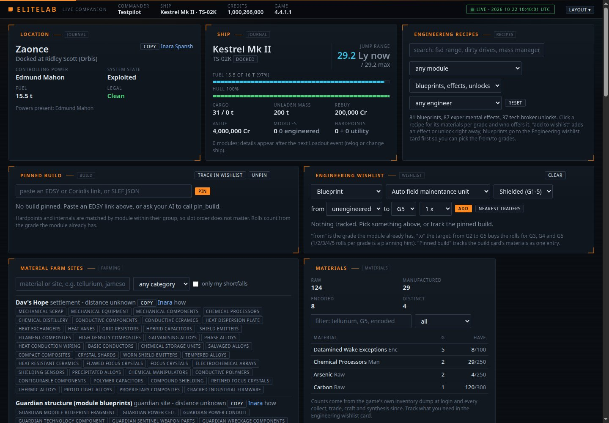
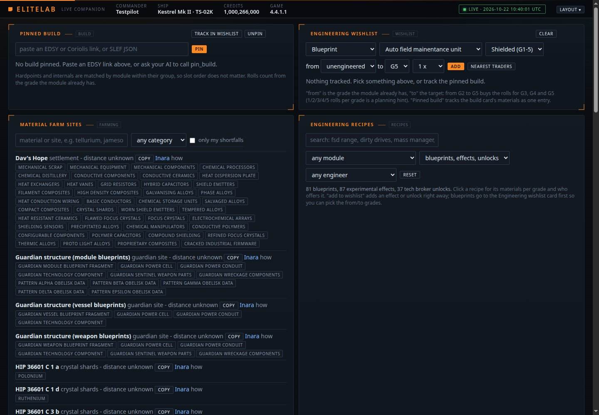
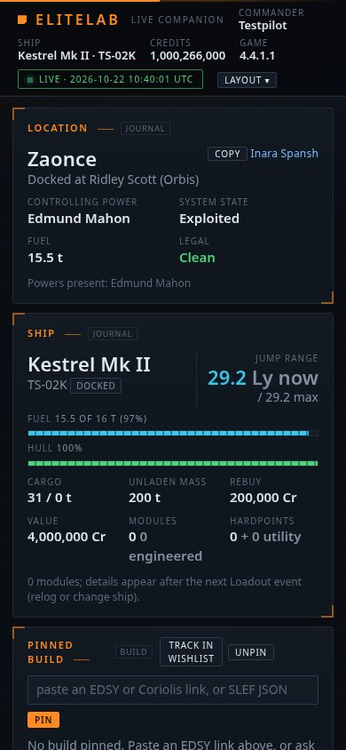

# EliteLab

A small, self-hosted dashboard for Elite Dangerous that an AI assistant can also talk to. It reads the game's journal files on your PC, shows what is going on right now (location, ship, cargo, Powerplay, carrier, materials, a star map), and exposes the same data as tools that Claude Code, any MCP client, or a shell script can call.

This project is vibe coded. I built it with an AI assistant while playing, to test things out in Elite and to have a dashboard I can interact with and call on with AI help. It is not polished software and does not try to be. Anyone is welcome to fork it, mess around with it, rip modules out, add their own, or take it somewhere else entirely. If you find a bug, open an issue with the journal lines around it. If you build a module, open a PR. Nothing fancy.

No accounts, no uploads, no dependencies: Python standard library, one web page, no build step.



The current desktop layout. Screenshots use the bundled sample journals; live market data and personal builds depend on your session.

### Engineering workspace

Switch to the Engineering preset to bring build planning, the wishlist, recipes, and material farming together.



<details>
<summary>See the mobile layout</summary>

Cards stack vertically on narrow screens, keeping commander, location, and ship information readable.



</details>

Opening **Start EliteLab** again reuses the running dashboard. Starting a different
copy or changed build asks you to stop the existing instance first. The startup
terminal prints the exact app folder. Use **Quit EliteLab** in the dashboard footer
or Ctrl+C in that terminal to stop the app and close its party; closing a browser
tab alone does not stop the server. Windows dashboard and party ports are exclusive.

## What it does

| Module | Dashboard card(s) | AI tools |
|---|---|---|
| journal | Location, Ship, Cargo, Rares at this market, Live feed | `get_commander_state` |
| carrier | Fleet carrier: owned details or one pinned visitor carrier | `get_followed_carrier`, `pin_fleet_carrier`, `unpin_fleet_carrier`, `refresh_followed_carrier` |
| trade | Carrier stock ledger, loading/unloading plan, margins, run counts and buy/sell stops; team operation stages, crew workload split and profit shares, delivery corrections and diagnostics | `get_carrier_trade`, `plan_carrier_trade`, `reconcile_carrier_stock`, `reset_carrier_inventory`, `get_trade_profiles`, `find_carrier_opportunities`, `select_carrier_opportunity`, `find_trade_spots`, `get_carrier_price_reference`, `manage_carrier_operation`, `configure_trade_workload`, `preview_trade_profit`, `correct_hauling_delivery`, `export_hauling_diagnostics` |
| party | Private LAN/tailnet hauling party: member cargo and location, shared leader plan, crew activity and delivery reports | `get_hauling_party`, `host_hauling_party`, `join_hauling_party`, `report_hauling_work`, `leave_hauling_party` |
| powerplay | Power, rank, merits, merits this session, cycle countdown | `get_powerplay_status` |
| merits | Merits per hour and per activity, worked out from the journal | `get_merits_summary` |
| combat | Where combat pays merits: contested systems with combat zones, acquisition, undermining, reinforcement | `find_combat_systems` |
| targets | [Rare sell targets: per-good source distances, price curves, conditional merits per jump, freshness and cargo restrictions](docs/SELL-TARGETS.md); power comparison | `find_sell_targets`, `compare_powers`, `get_system_info` |
| loop | Rare goods loop that ticks itself from your hold, sorted by distance, with the next stop | `get_rares_loop`, `select_rares_loop` |
| materials | Inventory as the game reports it, filterable; where-to-farm hints; a flat per-material wishlist for scripts | `get_materials`, `set_wishlist`, `get_wishlist`, `material_sources` |
| recipes | Engineering blueprints G1-G5 and experimental effects with materials per grade and which engineers offer them; searchable | `list_recipes`, `get_recipe` |
| wishlist | Engineering wishlist: pick a blueprint (from grade X to grade Y), experimental effect, tech broker unlock or material; have/need/short against live inventory; material trader plan for the shortfalls; nearest traders | `get_engineering_wishlist`, `wishlist_add`, `wishlist_remove`, `wishlist_options`, `plan_material_trades`, `find_material_traders` |
| farming | Where to farm: crystal shards, brain trees, Dav's Hope, Jameson, Guardian structures, HGE by state; nearest first, flagged when they cover a wishlist shortfall; map layer | `find_farm_sites` |
| build | Pin an EDSY or Coriolis build (or SLEF JSON) and measure your ship against it: modules to buy (with credits), blueprints and grades still to roll, effects, every material vs inventory, one click to track it on the wishlist | `get_build_progress`, `pin_build`, `unpin_build`, `build_to_wishlist` |
| history | [Credit snapshots, merit cycles, material locations and map history](docs/HISTORY.md) | `get_journal_history`, `get_journal_index`, `rebuild_journal_index`, `get_travel_history` |
| mining | [Nearby rings, hotspot reports, Powerplay buyer candidates, observed merits, prospector composition, refinery output and session profit](docs/MINING.md) | `get_mining_status`, `find_mining_spots`, `find_mining_buyers` |
| map | Star map: starfield, visited systems coloured by star class, route trail, layers from other modules | `get_system_coords` |
| core | Header, live connection, layout, Quit EliteLab | `get_state`, `get_recent_events`, `list_modules`, `list_tools`, `health`, `stop_elitelab` |

Everything updates live over Server-Sent Events the moment the game writes a journal line. Cards can be dragged, resized, hidden, saved as named layouts, or switched between presets (Powerplay, Rares run, Combat, Mining and trade, Engineering, Second screen).

You do not need to own a fleet carrier to use the Fleet carrier card. Choose a carrier from your journal visits and click **Pin** to follow its last reported system and services. The selection survives restarts. Your journal updates it when you dock, log in aboard, or ride a jump; Spansh reports are checked every five minutes while EliteLab runs. **Refresh** uses the same five-minute cache. Reports can lag behind movements, so the card shows the source, observation time and last check separately. Offline mode keeps saved observations. **Unpin** restores the owned-carrier view, if available. Fuel, balance and free capacity are owner-only information. If the card is hidden by your layout preset, enable **Fleet carrier** in the Layout menu.

## Quick start

### Expedition and research

Choose **Layout > Expedition** for neutron routing, ship readiness, synthesis
supplies and upcoming waypoints on the star map. Spansh plans use normal jump
range and detect the Caspian special FSD's 6x multiplier from the actual loadout.
Routes survive restarts. The Palin bar uses recorded maximum distance from
career start, with unknown evidence kept explicit.

Search 35 synthesis recipes, see how many your materials support, and combine
several recipes into one budget. FSD injections and jet-cone boosts have separate
journal evidence; their bonuses are never stacked. See the
[expedition guide](docs/NEUTRON-HIGHWAY.md).

The MCP can also resume [ship engineering](docs/ENGINEERING-RESEARCH.md), check
[actual modules and routes](docs/FLIGHT-RESEARCH.md), investigate
[engineer unlocks](docs/UNLOCK-RESEARCH.md), and build a
[mission supply checklist](docs/MISSION-SUPPLIES.md).

For access through a trusted DNS name, set `ELITELAB_ALLOWED_HOSTS` to that
hostname. IP-address URLs continue to work. See the
[security review and network boundary](docs/EXPEDITION-SECURITY.md).


### Carrier operations and hauling parties

Choose **Layout > Carrier ops**. The layout starts with **My next run** and
**Crew progress**, followed by **Carrier job** for the owner's route and controls.

**My next run** shows your next pickup or delivery, suggested tonnes based on
ship capacity and crew reports, copy buttons for systems/stations/quantities,
and estimated margin for that run. Cargo already aboard changes the action to
delivery. Carrier owners get direct-transfer instructions. Loading and unloading
contributions are separate, and locally saved deliveries awaiting acknowledgement
are labelled pending. The panel keeps inputs and destination text mounted during
live updates. Unknown quantities and prices remain unknown. Owners can use it
solo before hosting a party. The Compact button reduces explanatory text.

**Crew workload**, inside **Carrier job > Current job**, defaults new dashboard
plans to **Live loads**. It updates from acknowledged deliveries, available cargo
space and connected crew throughout the haul. A faster commander can keep hauling
past the initial estimate. For a final 1,160 t pickup with 1,136 t and 1,200 t ships,
the larger ship gets the whole pickup. If one ship cannot carry the remainder,
the pickup is split across the fewest available ships. Cargo already aboard is
deducted first: 1,188 t remaining with 1,136 t aboard leaves 52 t to pick up.

Unpicked work moves to available crew when someone leaves or goes away. Observed
cargo aboard absent ships stays accounted for until delivered; it is not assigned
again as new purchases. The owner table and each personal panel use the same
next-pickup data. Total tonnes and loads per commander are changing estimates.
Existing jobs keep their selected mode; choose **Live loads > Use live loads** to
switch an active job on the updated backend.

Choose **Equal tonnes per commander** for fixed equal shares, independent of ship
capacity, or **Custom shares** for relative weights (2 gets twice the unfinished
tonnes of 1; 0 sits out). **I haul too** includes the owner's direct transfers.
Starting loading also applies the displayed allocation choices.

The carrier buy-order quantity excludes the owner's remaining direct-transfer
share. In equal mode, for 12,000 t divided among an owner and two friends, each gets 4,000 t and
the initial buy order is 8,000 t. Crew deliveries reduce that order quantity;
owner transfers reduce their separate balance. The calculator provides copyable
order tonnes and price, plus the funding needed at that price. Owner profit
estimates exclude crew payouts on tonnes the owner hauls directly.
In live mode the owner's future share and order quantity are estimates that update
as the crew works; update the actual carrier order in game. The active operation
uses its target minus acknowledged deliveries, not the separate inventory ledger,
which can lag purchases made by other commanders.

Each personal panel shows assigned/delivered/remaining tonnes and estimated
loads left, including the final partial load. Pickup suggestions deduct cargo
already aboard: 350 t left with 100 t aboard requests 250 t more, then delivery
of 350 t. During an active equal split, new ready crew automatically receive a
share of the remaining work. Completed deliveries, assigned cargo already aboard,
and absent crew's reserved shares are kept. Arrival after departure only adds
unloading work. Personal loads and suggested carrier order tonnes update for
everyone; the owner still updates the order in game. Reconnecting with the same
identity keeps the saved assignment.

Custom splits keep the owner's chosen weights: choose the newcomer's share, then
use **Recalculate** and **Rebalance remaining work**. These controls also let the
owner redistribute work when someone leaves or changes participation.

**Individual profits** appear in Crew progress and **Delivered by crew & individual
profits** in Carrier job. Each commander sees recorded loading/unloading profit,
estimated profit on their remaining assignment, and estimated total profit.
The personal panel shows the same figures. Only acknowledged deliveries count;
pending reports and cargo aboard are not earnings. Figures use agreed prices,
exclude fuel, fees and personal bonuses, and follow corrections and rebalancing.
Unknown prices or unassigned future work stay unknown. Ended jobs show recorded
profit without projecting unfinished work. Carrier profit is a separate job
estimate; the owner's direct transfers are not counted as crew payments.

**Crew progress** shows both job targets and each commander's acknowledged
contribution. A departing commander's deliveries remain in the roster. Telemetry
is available under **Ship status and telemetry**. Reported margin uses agreed
prices, excludes expenses/bonuses, and is not a verified credit balance.
The roster also includes compact ship/flight, cargo, fuel and shield readings;
critical alerts are highlighted and disconnected readings are marked stale.
Buy, carrier and sell locations in Crew progress have Inara market links alongside
the copy buttons. Carrier links use the callsign so they remain useful after jumps.

Closing a party sends a terminal response to connected clients before releasing
its listener (up to three seconds). Members return to the join screen and keep
saved deliveries. If an offline client misses that response, it retains explicitly
stale evidence while retrying; an expired invitation detaches it when a new room
appears. **Leave party** remains at the top of Crew progress. Prepared and ended
trades have distinct messages, and expanded profit/history sections survive live
updates.

**Delivery history & corrections**, under **Carrier job > Current job**, shows
accepted reports, their latest local journal/manual evidence, stage changes and
owner corrections. To fix a mistaken report, the owner chooses a commander and
leg, enters the **correct total delivered** and a reason, then saves. This changes
credited progress without changing physical cargo or deleting the original report.
New reports cannot silently overwrite the correction. If progress changes while
the form is being edited, refresh its totals before saving.

Use **Export test data** after each test job, before starting another. It downloads
a JSON file containing quantities, assignments, corrections and retained history;
nothing is uploaded. Commander aliases match across clients for the same job.
Names, connection secrets/addresses, free-text notes/reasons, credit balances and
full journals are omitted. The owner export contains up to 2,000 history entries;
member exports contain the latest 20 shared entries plus their pending local totals.
For troubleshooting, keep the owner's export and an affected member's export.

**Carrier job** finds paired buy/sell routes
inside the dashboard. For each high-paying buyer, it picks the cheapest
qualifying supplier within the chosen **Buy to sell** distance. Results are
ranked by spread per ton, then lower buy price and shorter route distance.
Both stops, prices, supply/demand, observation times and distance between stops
appear together. Copy system and station names independently, or open **Inara market**
in a new tab beside either stop. The same links appear in **My next run** and
**Current job**. Station lookups include the system; carrier links use the
callsign so they remain useful after a jump. Inara must have a listing for the stop.

Reports come from **Ardent / EDDN**, not Inara. Defaults: 100 Ly between stops,
both stops within 100 Ly of your carrier, reports within six hours, large pads,
supply and demand sufficient to fill all reported carrier free space, station
approaches within 10,000 Ls, and
sell prices at least 80% of the highest qualifying reported sell price for that
commodity. Adjust these in **Search settings**. Unknown inter-stop distances
are excluded. The carrier radius applies to both buy and sell stops.

**Bulk shortlist** screens 24 commodities ranked by catalog spread; expand to
48 or 96, or select any individual commodity from the catalog/carrier list.
Catalog figures only choose candidates: fresh station reports determine prices.
Up to 100 quotes per side are paired before selecting the top eighteen results.
This is a bounded search, not a guarantee of the galaxy's best route. Reports
refresh every five minutes while the card is visible and can change on arrival.

Carrier free space and reported supply/demand size the new load. Each result
shows purchase cost, gross spread, loading and unloading run counts, existing
stock and orders. Spread excludes fuel, fees, hauler payments and Powerplay
bonuses. Stock and orders do not restrict which commodities can be searched.
**Use route** saves both stops/prices into a loading operation. Unknown or
conflicting stock needs reconciliation to establish its target; this does not
hide routes. The supply/demand minimum follows carrier free space automatically; untick
**Fill carrier free space** to override it. Unknown/full capacity requires a
manual minimum to browse routes without an executable loading quantity. **Adjust operation** exposes target stock, prices,
ship capacity and optional personal bonuses. Physical stock, ship cargo and
orders stay separate. Plans do not place orders in game.

Carrier orders show the **percentage to set in game**, expected Cr/t, and crew-only
tonnes. Route reports supply the commodity's `meanPrice` reference automatically.
**Refresh carrier pricing** uses the newest local or Ardent/EDDN reference within
24 hours. Its source and time are shown. If the in-game 100% price differs, enter
that value under **Adjust operation** and save before starting. Missing references
remain target estimates; automatic crew pricing cannot start without a reference.
The in-game displayed price takes precedence over community reports.

**Crew profit split** starts at 25% for loading and 25% for unloading, leaving
50% to the carrier. Edit either crew share to recalculate every result without
querying markets again. **Total route profit** is the full station-to-station
spread; **Your carrier profit** deducts both crew payments. Both exclude fuel
and fees. Each leg shows the carrier order price, hauler earnings per tonne and
the total paid for that leg, with a Copy % button.

Carrier buy price = station buy price + loading reward. Carrier sell price =
station sell price - unloading reward. These are target prices. Actual carrier
orders use the nearest whole percentage
settings within the planner's 5%-1000% range and within the station-to-station
spread. The resulting prices determine crew payouts and owner profit; the requested
split may shift slightly after rounding. These are aggregate crew shares,
paid by tonnage hauled, not equal payments per connected member. **Use route**
saves the chosen split and full operation quantity. In **Adjust operation**,
auto crew pricing chooses the corresponding order price for Load or Unload.
Both prices are shared with the hauling party; game orders still require manual
entry. Legacy/manual plans retain their prices unless auto crew pricing is enabled.

**Personal Powerplay bonus** shows journal-reported power and rank. Enter a
verified additional bonus in Cr/t and confirm its applicability to your rank,
commodity and destination. The bonus stays separate from carrier-market profit;
"Sell price already includes bonus" prevents double counting. Changing the
route clears confirmation, and pledge/rank changes invalidate it.

The inventory ledger reads older journals once at startup to recover carrier
orders and locally observed trades/transfers. Sale orders establish stock;
purchase orders never do. Manual counts are replay baselines, so later transfers
still apply. Other commanders' trades can be missing. Historical counts are
partial evidence; reconcile against the carrier in game. Saved counts and plans
survive restarts. Party cargo never becomes delivered carrier stock automatically.

**Clear inventory & orders** discards stale ledger rows and starts tracking from
now. Older journals cannot recreate cleared counts/orders. The optional tritium
row keeps its quantity unknown until checked. A pre-reset ledger backup is saved
locally; this changes no in-game cargo, saved trade plans or operation reports.

**Manage trade** separates the selected job from route searches. **Prepare trade**
saves the route and asks for current physical stock inline if it is unknown.
Set the carrier buy order in game, then choose **Start loading**. The owner can
pause/resume new runs, confirm loading finished and depart, open unloading, and
finish or cancel. Moving to unloading sets the saved carrier sell price and
retains the starting stock as the final target. The active route/prices are
locked until the operation ends. Stage transitions do not invent delivery counts.

Crew see the current task, carrier, price and owner instructions. Each commander
can mark themselves Ready/Hauling/Away. While joined to an active leg, matching
journal sales automatically record deliveries: sales to the carrier count as
loading; sales at the chosen destination count as unloading. Owner transfers
to the carrier also count as loading when its docking market ID matches.
Loading and unloading progress and the per-commander totals are crew reports,
separate from journal inventory and cargo in transit. Cumulative totals and
local identity survive restart; reconnects and repeated heartbeats do not add
the same delivery again. Journal event fingerprints also survive restart. The
watcher performs no network calls; heartbeats send the saved totals. Ordinary
replay, purchases, cargo snapshots and unrelated markets/commodities do not count.
After restart or rejoining the same job, a separate local journal check recovers
missed deliveries once. It starts when this version first tracked that job and
uses saved phase times and event fingerprints. Pickup instructions and manual
entry wait while the check runs. Members must rejoin the leader first. Cancelled
jobs and events already covered by a manual report or owner correction are not
backfilled. Older jobs without an unloading start time show a manual-check notice;
upgrading does not guess at deliveries before tracking began.
**Manual delivery fallback** is only for missing journal evidence or plans
without verified market IDs; never enter an already auto-recorded delivery.
Failed sends are retained locally for retry. Completed deliveries can still be reported during a
pause. Final profit remains an estimate, not a payout ledger.

For multiplayer on a LAN or your Tailscale tailnet:

1. Everyone runs their own EliteLab and joins the same tailnet.
2. The leader selects **Create party as leader**. Prefer the leader's Tailscale
   IPv4 as the listen address; `0.0.0.0` listens on all local interfaces. The
   party port defaults to `8767`, separate from the dashboard's `8766`.
3. Share `http://LEADER-TAILSCALE-IP:8767` and the generated party code.
4. Members enter that URL/code under **Join a leader** on their own dashboard.
   They share commander name, location, ship, capacity and cargo every 3 seconds.
   Members also receive the leader's saved plan and the party roster.
5. The owner starts the saved trade in **Manage trade**. Crew journals update progress automatically;
   the owner advances the shared stages.
6. **Leave party** stops sharing; on the leader it closes the listener and
   invalidates the code. Parties do not reconnect automatically after restart.

Allow the party port through Windows Firewall and tailnet access rules if needed.
Keep the main dashboard bound to localhost; friends do not need its controls.
The party listener accepts only authenticated telemetry, not dashboard routes.
HTTP is for private LAN/Tailscale connections (Tailscale supplies encryption);
this is not a public internet hosting setup. Reports become stale after 30 seconds
without a heartbeat and expire after 5 minutes. Cargo observation times remain
visible even while a client is connected; an open EliteLab is not proof that the
game is currently running. Party codes and member data are kept in memory.

Market lookup uses the [Ardent API](https://github.com/iaincollins/ardent-api).
Journal accounting follows Frontier's
[Player Journal manual](https://hosting.zaonce.net/community/journal/v37/Journal_Manual_v37.pdf).

### Windows, no Docker

The Windows CI workflow builds a per-user installer artifact. It installs into
`%LOCALAPPDATA%\Programs\EliteLab` by default without an administrator prompt
and offers an optional desktop shortcut. It is not published as a release asset
yet. The installer is unsigned, so Windows may show a warning; check the
published SHA-256 alongside the artifact before running it. Quit EliteLab before
installing, upgrading or uninstalling; the installer
checks the standard instance guard and refuses to proceed while it is locked.
If you set `ELITELAB_INSTANCE_DIR`, launch setup with the same absolute value.
Setup accepts an empty destination or a recent EliteLab bundle folder containing
the `.windows-bundle` marker, so it does not overwrite an unrelated nonempty
folder. Install older unmarked bundles into a new folder. Uninstall removes application
files and shortcuts while preserving settings and data. Do not delete your old
bundle or its data until you have verified the new installation.


Download the source ZIP from GitHub and extract it completely into a writable
folder. Install Python 3.10 or newer from python.org with **Add Python to PATH**
enabled, or use the portable Windows bundle which includes Python.

New Windows bundles store app data in `%LOCALAPPDATA%\EliteLab\data` by default.
A pre-existing `data` folder beside the bundle is still used. When upgrading an
older bundle into a different folder, choose its old `data` folder in setup or
copy it to the new default before starting. Configured data paths still take precedence.

For the portable Windows bundle, double-click **Launch EliteLab.vbs**. On first
launch it opens setup; choose your journal folder, click **Test**, then **Save**
and **Restart** if requested. Use **Quit EliteLab** in the notification-area
menu or **Quit** in the dashboard to stop the server. The tray menu can also
open the dashboard or setup; double-click its icon to open the dashboard.
Closing the window alone leaves the server running. Tray actions require a
loopback-accessible server; use the dashboard controls if bound only to a
specific network address. Startup errors point to a
log under the configured data folder. The bundle opens an app window using
Edge, Chrome, Brave or Chromium, with a dedicated browser profile in the data
folder; if no supported browser can be launched, it opens the default browser.

For a source ZIP, double-click **Setup EliteLab.cmd**. It checks `python`, then
`py -3`, and opens setup after the lab answers its health check. Keep its terminal
open while using the lab, and use **Start EliteLab.cmd** on subsequent launches.
The `.cmd` launchers are also available in the portable bundle for troubleshooting.

A source ZIP needs no Git, Docker, Node or extra Python packages. For a custom
settings file, run from a terminal:

```bat
"Setup EliteLab.cmd" --settings "C:\EliteLab settings\settings.json"
```

### Linux and macOS

Extract the source ZIP into a writable directory. Install Python 3.10 or newer
using your Linux package manager or python.org on macOS, then run:

```sh
sh setup.sh
```

The script checks `python3`, then `python`, and opens setup after a ready health
response. You can set `ELITELAB_PYTHON` to an interpreter path if needed. Select a
Steam/Proton journal candidate, or choose a custom/synced journal folder. Save and
restart when prompted. Next time, run `sh start.sh serve --open-browser`.

For a custom settings file or a busy default port:

```sh
sh setup.sh --settings "/path with spaces/settings.json" --port 8799
```

A command-line port overrides a saved port for that launch. To keep it for later,
save the port in setup and omit `--port` on subsequent launches. Options such as
`--journals` have the same precedence; use setup's Save for persistent choices.
`--no-browser` disables automatic browser opening for headless use. The terminal
prints the correct setup URL, including a custom port.

### Setup troubleshooting and updates

- **Python missing or too old:** install or upgrade Python 3.10+, reopen the
  terminal, and rerun setup. On Windows enable Add Python to PATH, or use the
  portable bundle. On Linux/macOS check `python3 --version` or `python --version`.
- **No journals found:** open setup, enter the actual or synced journal folder and
  click Test. A missing folder is reported without replacing the saved choice.
- **Port in use:** stop the other process or launch setup with `--port 8799` (or
  another free port), save that port, then omit the flag on future launches.
- **Browser did not open:** use the setup URL printed in the terminal. If an auth
  token is configured, sign in with it. Keep the server terminal open.
- **Already running:** setup reopens the matching instance. A different app copy
  or changed build must be stopped before launching this copy.
- **Update:** quit EliteLab, preserve the existing `data` directory (or your saved
  custom data path), and replace the application files with the new extracted
  release. Keep the platform settings file. Run setup again to verify paths;
  it does not reset settings, wishlists or saved layouts. If moving to a different
  folder, move the source `data` directory with it or save an absolute data path.

The setup scripts are included in source archives and the Windows bundle includes
its setup entry point. Installers, tray behavior and a Mac package remain separate
work under #9 and #55.

### First run

Open http://localhost:8766/setup/. The page lists the Elite Dangerous journal folders it found (Windows Saved Games, Steam Proton including Flatpak Steam and every Steam library, and the Mac Application Support folder), or you can type a path and click **Test** to see how many journals it holds. Pick the folder, save, and click **Restart** if the page says a restart is needed; it waits for the lab to come back and opens the dashboard. When no journal files are found, the dashboard banner links to this page. Saving only writes the settings file, and nothing changes until the restart.

The settings file is `%APPDATA%\EliteLab\settings.json` on Windows and `$XDG_CONFIG_HOME/elitelab/settings.json` elsewhere (`~/.config/elitelab/settings.json` by default). Command line flags and environment variables still win over the file, so a Docker setup behaves as before; the page warns when one of them will override a value you save. Restart works under `start.sh` and `Start EliteLab.cmd`, which start the lab again when it exits with status 75; run the server any other way and Restart simply stops it.

## Trading

Choose **Layout > Trading** for ship-sized Spansh trade routes.
Leave Starting system blank to use your current journal location; leave
Destination blank to search any buyer within range. Choose a light-year limit
(up to 500 Ly), or an estimated number of jumps using your current ship's fully
laden range. Blank load size uses ship cargo capacity; enter a smaller load if
your hold or budget is limited. The minimum pad defaults to Large and is editable.

Choose **Round trip** (default) or **One way**. Round trips return to the exact
starting station, with independently chosen return cargo. An optional starting
station narrows the origin; the destination field is a system name. Each leg
must have reported supply and positive demand for the full load. Fleet carriers
are excluded; surface stations are optional and excluded by default.

The search ranks up to 30 routes by combined load profit in a comparison table:
profit, profit per tonne of hold, light-years and estimated laden jumps per leg,
return on purchase costs, starting credits needed, the age of the oldest market
report and the landing pads. The top ten show first; Details expands a route
into its outbound and return legs with prices, supply/demand, timestamps,
approach distances and copy buttons. Inara is the preferred external market and
prefilled station-pair route view; its website filters may differ from the
local search. Station, pad, report age, approach, goods and breadth filters sit
under More filters.

**Select** makes a route the active plan. The panel at the top of Trading then
names your next action from the journal: travel to the buy station, buy the
load (less what is already aboard) once docked there exactly, travel to the sell
station, sell, and for round trips the return leg. It shows straight-line
distance, tonnes of the planned goods aboard, report age and whether reported
credits cover the purchase. Show on map draws the route on the star map with a
dashed line to the next stop; Copy system/station fill the clipboard. The plan
is saved on the server, so it survives restarts and is the same for every
browser and MCP client. A leg counts as sold only from MarketSell events at the
planned station after selection; cargo aboard is never treated as a purchase
receipt. See [docs/TRADING.md](docs/TRADING.md) for the full workflow.

Search checks the nearest 100 eligible stations by default (200/300 optional),
plus up to 100 origin markets. All available goods are compared; the commodity
selector restricts outbound cargo only. Coverage warnings show when the station
limit is reached. Reports are cached five minutes and can change before arrival.
Jump estimates use straight-line distance per leg, not a plotted route; profits
exclude fuel, fees and personal bonuses. Routes exceeding your reported credits
or capacity show a warning; reduce the load before flying them.
Search results retain the original settings until you run another search.

The `find_personal_trade_routes` tool exposes the same search via HTTP/MCP/CLI;
`select_trade_route`, `get_trade_plan` and `clear_trade_route` manage the plan.

## Talking to it from an AI

With the lab running, open the repo folder in Claude Code. The `.mcp.json` in the repo registers the `elitelab` MCP server automatically. Then ask things like:

> I want to work on getting materials for an FSD G5 Increased Range roll.

The assistant adds the blueprint to your engineering wishlist, reads your shortfalls, suggests material trader exchanges from your surplus, and tells you where to farm the rest. The Engineering wishlist card shows the same shortfalls going down as you collect.

Any agent with a shell can do the same without MCP:

```
python -m elitelab tools
python -m elitelab call get_materials only_short=true
python -m elitelab call find_sell_targets min=125 max=165
```

See docs/AI.md.

## Configuration

| Variable | Default | Meaning |
|---|---|---|
| `ELITELAB_SETTINGS` / `--settings PATH` | platform path (see First run) | Settings file to read and write. Order of precedence: flag, environment, settings file, default |
| `ELITELAB_HOST` / `ELITELAB_PORT` | `127.0.0.1` / `8766` | Bind address (`0.0.0.0` in Docker) and port; an IPv4 address or a host name. Empty means the default |
| `ELITELAB_AUTH_TOKEN` | | When set, `/api/*` and `/events` need `Authorization: Bearer TOKEN` or the session cookie from `POST /api/login`; Host validation still applies |
| `ELITELAB_ALLOWED_HOSTS` | | Comma-separated extra host names a POST may use in its Host header, for example `nas.local` (see below) |
| `ELITELAB_JOURNAL_DIR` | `/journals` in Docker, else the first detected folder with journals (Windows Saved Games, Steam Proton, Mac Application Support), else the Windows Saved Games path | Where the game writes `Journal.*.log` |
| `ELITELAB_BROWSER` | | Browser executable for the Windows portable app window; set it here or as `browser` in the settings file |
| `ELITELAB_DATA_DIR` | `./data` (new Windows bundles: `%LOCALAPPDATA%\EliteLab\data`) | Persistent files (wishlist, selected loop) |
| `ELITELAB_RECENT_JOURNALS` | `3` | Journal files replayed at startup |
| `ELITELAB_DISABLE` | | Comma-separated module names to skip |
| `ELITELAB_OFFLINE` | | Set to `1` to never call Spansh or EDSM (tests use this) |
| `ELITELAB_URL` | `http://127.0.0.1:8766` | Where the MCP proxy finds the lab |

The server answers a request only when its Host header is an IP address, `localhost`, the bind host, this machine's own name, or a name in `ELITELAB_ALLOWED_HOSTS`; any other gets 403 with the variable to set. This holds on every bind, so a DNS-rebinding web page (which always needs a DNS name) cannot change anything, while opening the dashboard by IP or by the machine's name keeps working. Bind to `0.0.0.0` to open the dashboard from a tablet on your LAN; this machine's own name is its short host name, so if you reach it by any other name, such as `nas.local`, a fully qualified name or a Tailscale MagicDNS name, add that name to `ELITELAB_ALLOWED_HOSTS`. Inside Docker the container's own name is not the host's name, so reaching the container by the host's name needs `ELITELAB_ALLOWED_HOSTS`. Without a token there is no auth, so do not expose it to the internet.

The setup changes (`POST /api/setup`, `/api/setup/journals` and `/api/restart`) go one step further: without `ELITELAB_AUTH_TOKEN` they are answered only when the connection itself comes from this machine (a loopback address); from any other address they get 403 "Setup changes require a local connection or configured authentication." A tablet on your LAN can still use the dashboard and its other actions, such as the wishlist, but changing settings from it needs a token. In Docker the browser's connection reaches the container from the bridge network, not loopback, so the setup page can only save there with `ELITELAB_AUTH_TOKEN` set (or edit the settings file and environment instead). The same goes for an AI: the MCP proxy running on the host reaches a Docker lab through the bridge too, so `save_setup` and `restart_elitelab` need the token there (set it where the proxy runs as well).

## How it is built

```
game journal --> watcher --> event bus --> modules --> state store --> SSE --> browser cards
                                              |
                                              +--> routes = /api/* = MCP tools
```

A core (bus, store, services, HTTP, loader, journal watcher) and modules that declare what they require and provide. Modules talk only through the store and the bus. The loader sorts them by dependency and refuses to start on a missing one. Every route registered with a tool name is automatically an MCP tool.

- docs/ARCHITECTURE.md: how the pieces fit
- docs/MODULES.md: how to write a module
- docs/API.md: every endpoint and tool, generated from `/api/schema`
- docs/AI.md: MCP, shell and HTTP usage for assistants
- ROADMAP.md: what I want to do next
- CONTRIBUTING.md: how to help

## Tests

```
python -m unittest discover -s tests -v
```

Runs offline against a synthetic journal in `tests/fixtures/journals`. CI runs the same on Linux and Windows, syntax-checks the front end, and builds the Docker image.

## Similar projects

EliteLab is small and Powerplay-first. For more complete tools, see:

- EDMarketConnector (https://github.com/EDCD/EDMarketConnector): the standard journal uploader (Inara, EDDN, EDSM) with a plugin API.
- EDDiscovery (https://github.com/EDDiscovery/EDDiscovery): full logbook, 3D galaxy map, materials, carrier panel.
- Odyssey Materials Helper (https://github.com/jixxed/ed-odyssey-materials-helper): blueprint-level materials planning.
- Elite Observatory (https://github.com/Xjph/ObservatoryCore): exploration-focused journal watcher with plugins.
- AI bridges: EDGPT (https://glama.ai/mcp/servers/bnrkhmvp3c) and Elite Dangerous Local AI Tie-In MCP (https://github.com/GWLlosa/elite-dangerous-local-ai-tie-in-mcp).

## Data sources and thanks

Spansh (https://spansh.co.uk) for station and system search, EDSM (https://www.edsm.net) for coordinates, and Frontier's Player Journal manual for the format. Elite Dangerous is a trademark of Frontier Developments plc. This project is not affiliated with Frontier.

## License

MIT. See LICENSE.

### Materials and recipes

Use **Materials / Recipes** to plan synthesis, FSD injections and engineering with
one saved wishlist and shared stock totals. [Workflow and MCP tools](docs/MATERIAL-PLAN.md).
Dashboard workspaces group related panels; **Custom layout** preserves existing layouts.
