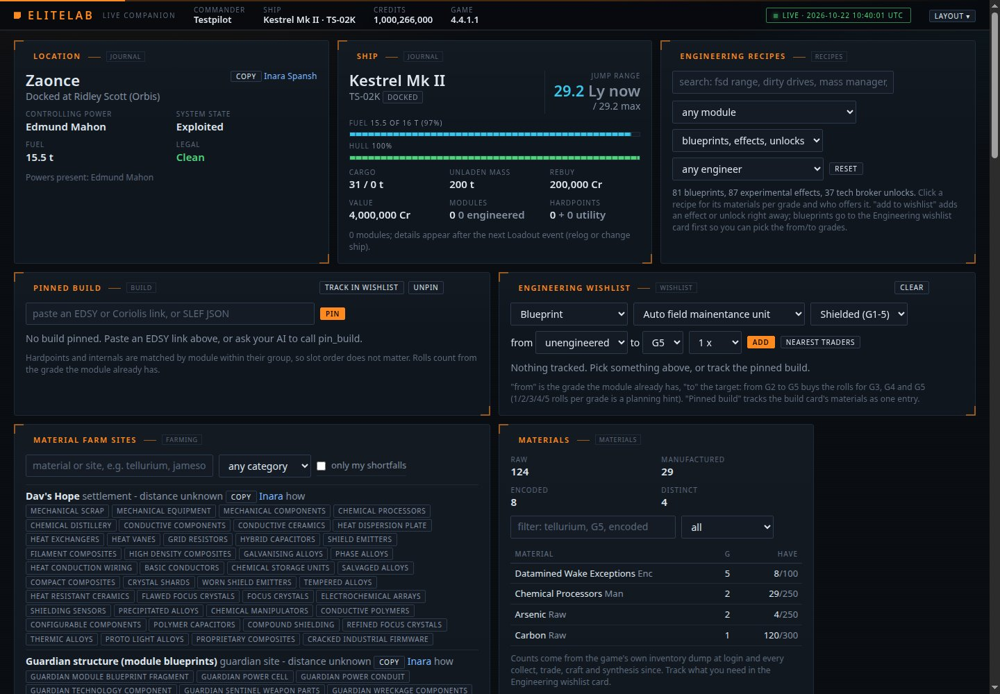
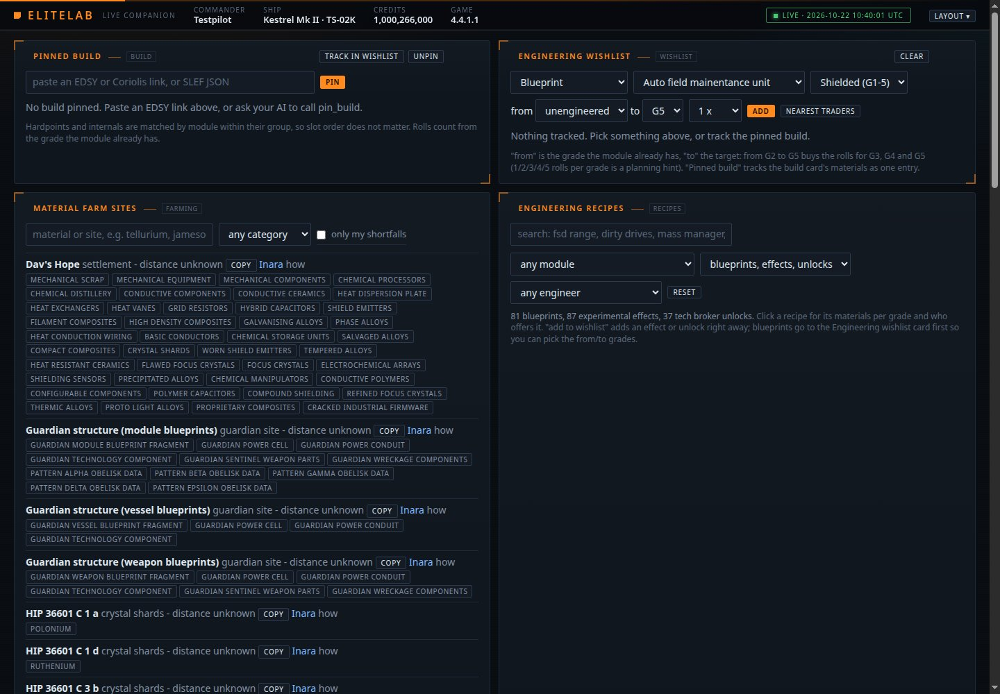
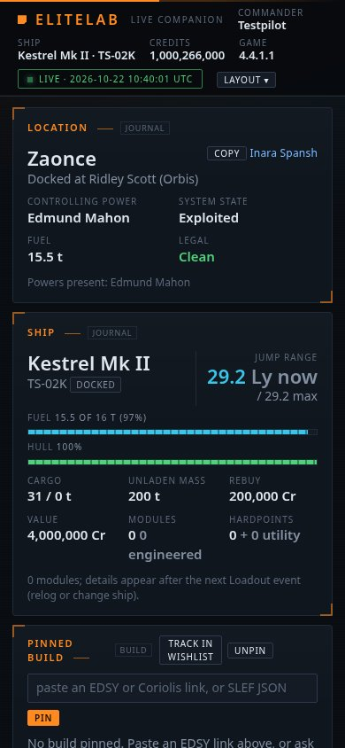

# EliteLab

A small, self-hosted dashboard for Elite Dangerous that an AI assistant can also talk to. It reads the game's journal files on your PC, shows what is going on right now (location, ship, cargo, Powerplay, carrier, materials, a star map), and exposes the same data as tools that Claude Code, any MCP client, or a shell script can call.

This project is vibe coded. I built it with an AI assistant while playing, to test things out in Elite and to have a dashboard I can interact with and call on with AI help. It is not polished software and does not try to be. Anyone is welcome to fork it, mess around with it, rip modules out, add their own, or take it somewhere else entirely. If you find a bug, open an issue with the journal lines around it. If you build a module, open a PR. Nothing fancy.

No accounts, no uploads, no dependencies: Python standard library, one web page, no build step.



The current desktop layout. Screenshots use the bundled sample journals; live market data and personal builds depend on your session.

### Engineering workspace

Switch to the Engineering preset to bring build planning, the wishlist, recipes, and material farming together.



<details>
<summary>See the mobile layout</summary>

Cards stack vertically on narrow screens, keeping commander, location, and ship information readable.



</details>

## What it does

| Module | Dashboard card(s) | AI tools |
|---|---|---|
| journal | Location, Ship, Cargo, Rares at this market, Live feed | `get_commander_state` |
| carrier | Fleet carrier: owned details or one pinned visitor carrier | `get_followed_carrier`, `pin_fleet_carrier`, `unpin_fleet_carrier`, `refresh_followed_carrier` |
| trade | Carrier stock ledger, loading/unloading plan, margins, run counts and buy/sell stops | `get_carrier_trade`, `plan_carrier_trade`, `reconcile_carrier_stock`, `get_trade_profiles`, `find_carrier_opportunities`, `select_carrier_opportunity` |
| party | Private LAN/tailnet hauling party: member cargo and location, shared leader plan | `get_hauling_party`, `host_hauling_party`, `join_hauling_party`, `leave_hauling_party` |
| powerplay | Power, rank, merits, merits this session, cycle countdown | `get_powerplay_status` |
| merits | Merits per hour and per activity, worked out from the journal | `get_merits_summary` |
| combat | Where combat pays merits: contested systems with combat zones, acquisition, undermining, reinforcement | `find_combat_systems` |
| targets | Powerplay sell-target finder with jump counts, market freshness, and warnings about rares a station will not buy; power comparison | `find_sell_targets`, `compare_powers`, `get_system_info` |
| loop | Rare goods loop that ticks itself from your hold, sorted by distance, with the next stop | `get_rares_loop`, `select_rares_loop` |
| materials | Inventory as the game reports it, filterable; where-to-farm hints; a flat per-material wishlist for scripts | `get_materials`, `set_wishlist`, `get_wishlist`, `material_sources` |
| recipes | Engineering blueprints G1-G5 and experimental effects with materials per grade and which engineers offer them; searchable | `list_recipes`, `get_recipe` |
| wishlist | Engineering wishlist: pick a blueprint (from grade X to grade Y), experimental effect, tech broker unlock or material; have/need/short against live inventory; material trader plan for the shortfalls; nearest traders | `get_engineering_wishlist`, `wishlist_add`, `wishlist_remove`, `wishlist_options`, `plan_material_trades`, `find_material_traders` |
| farming | Where to farm: crystal shards, brain trees, Dav's Hope, Jameson, Guardian structures, HGE by state; nearest first, flagged when they cover a wishlist shortfall; map layer | `find_farm_sites` |
| build | Pin an EDSY or Coriolis build (or SLEF JSON) and measure your ship against it: modules to buy (with credits), blueprints and grades still to roll, effects, every material vs inventory, one click to track it on the wishlist | `get_build_progress`, `pin_build`, `unpin_build`, `build_to_wishlist` |
| history | Feeds the map | `get_travel_history` |
| map | Star map: starfield, visited systems coloured by star class, route trail, layers from other modules | `get_system_coords` |
| core | Header, live connection, layout | `get_state`, `get_recent_events`, `list_modules`, `list_tools`, `health` |

Everything updates live over Server-Sent Events the moment the game writes a journal line. Cards can be dragged, resized, hidden, saved as named layouts, or switched between presets (Powerplay, Rares run, Combat, Mining and trade, Engineering, Second screen).

You do not need to own a fleet carrier to use the Fleet carrier card. Choose a carrier from your journal visits and click **Pin** to follow its last reported system and services. The selection survives restarts. Your journal updates it when you dock, log in aboard, or ride a jump; Spansh reports are checked every five minutes while EliteLab runs. **Refresh** uses the same five-minute cache. Reports can lag behind movements, so the card shows the source, observation time and last check separately. Offline mode keeps saved observations. **Unpin** restores the owned-carrier view, if available. Fuel, balance and free capacity are owner-only information. If the card is hidden by your layout preset, enable **Fleet carrier** in the Layout menu.

## Quick start

### Windows bundle (Python included)

Download the **EliteLab-windows-x64** artifact from the successful GitHub Actions
CI run for your branch. Inside the artifact is `EliteLab-windows-x64.zip`:
extract it fully and double-click **Start EliteLab.cmd** in the EliteLab folder.
Leave the terminal open while using the dashboard; Ctrl+C stops the server.
No separate Python installation or PATH setup is needed. The browser opens
after the server binds, and startup errors remain visible in the terminal.

The bundle includes the official CPython 3.13.17 x64 embedded runtime and its
license. The GitHub **Download ZIP** source archive does not include Python;
running from source still requires Python 3.10 or newer.

To build a bundle yourself, run `python scripts/build_windows.py`. The output
is `dist/EliteLab-windows-x64.zip`, with a SHA-256 checksum alongside it. The
build downloads a pinned runtime from python.org and verifies its published
checksum. It copies only application code/assets, the launcher and docs;
personal journals, `.env` and saved `data/` are excluded. Updates should retain
your existing `data/` folder after closing the old server.

### Carrier operations and hauling parties

Choose **Layout > Carrier ops**. **Carrier trades** finds paired buy/sell routes
inside the dashboard. For each high-paying buyer, it picks the cheapest
qualifying supplier within the chosen **Buy to sell** distance. Results are
ranked by spread per ton, then lower buy price and shorter route distance.
Both stops, prices, supply/demand, observation times and distance between stops
appear together. No PTN missions or external route tabs.

Reports come from **Ardent / EDDN**, not Inara. Defaults: 100 Ly between stops,
buy stops within 500 Ly of your carrier, reports within six hours, large pads,
supply and demand sufficient to fill all reported carrier free space, station
approaches within 10,000 Ls, and
sell prices at least 80% of the highest qualifying reported sell price for that
commodity. Adjust these in **Search settings**. Unknown inter-stop distances
are excluded. The carrier radius applies to buy stops, not to sell stops.

**Bulk shortlist** screens 24 commodities ranked by catalog spread; expand to
48 or 96, or select any individual commodity from the catalog/carrier list.
Catalog figures only choose candidates: fresh station reports determine prices.
Up to 100 quotes per side are paired before selecting the top eighteen results.
This is a bounded search, not a guarantee of the galaxy's best route. Reports
refresh every five minutes while the card is visible and can change on arrival.

Carrier free space and reported supply/demand size the new load. Each result
shows purchase cost, gross spread, loading and unloading run counts, existing
stock and orders. Spread excludes fuel, fees, hauler payments and Powerplay
bonuses. Stock and orders do not restrict which commodities can be searched.
**Use route** saves both stops/prices into a loading operation. Unknown or
conflicting stock needs reconciliation to establish its target; this does not
hide routes. The supply/demand minimum follows carrier free space automatically; untick
**Fill carrier free space** to override it. Unknown/full capacity requires a
manual minimum to browse routes without an executable loading quantity. **Adjust operation** exposes target stock, prices,
ship capacity and optional personal bonuses. Physical stock, ship cargo and
orders stay separate. Plans do not place orders in game.

**Crew profit split** starts at 25% for loading and 25% for unloading, leaving
50% to the carrier. Edit either crew share to recalculate every result without
querying markets again. **Total route profit** is the full station-to-station
spread; **Your carrier profit** deducts both crew payments. Both exclude fuel
and fees. Each leg shows the carrier order price, hauler earnings per tonne and
the total paid for that leg, with a copy-price button.

Carrier buy price = station buy price + loading reward. Carrier sell price =
station sell price - unloading reward. Rewards are rounded down to whole credits
per tonne; the remainder stays with the carrier. These are aggregate crew shares,
paid by tonnage hauled, not equal payments per connected member. **Use route**
saves the chosen split and full operation quantity. In **Adjust operation**,
auto crew pricing chooses the corresponding order price for Load or Unload.
Both prices are shared with the hauling party; game orders still require manual
entry. Legacy/manual plans retain their prices unless auto crew pricing is enabled.

**Personal Powerplay bonus** shows journal-reported power and rank. Enter a
verified additional bonus in Cr/t and confirm its applicability to your rank,
commodity and destination. The bonus stays separate from carrier-market profit;
"Sell price already includes bonus" prevents double counting. Changing the
route clears confirmation, and pledge/rank changes invalidate it.

The inventory ledger reads older journals once at startup to recover carrier
orders and locally observed trades/transfers. Sale orders establish stock;
purchase orders never do. Manual counts are replay baselines, so later transfers
still apply. Other commanders' trades can be missing. Historical counts are
partial evidence; reconcile against the carrier in game. Saved counts and plans
survive restarts. Party cargo never becomes delivered carrier stock automatically.

**Clear inventory & orders** discards stale ledger rows and starts tracking from
now. Older journals cannot recreate cleared counts/orders. The optional tritium
row keeps its quantity unknown until checked. A pre-reset ledger backup is saved
locally; this changes no in-game cargo, saved trade plans or operation reports.

**Manage trade** separates the selected job from route searches. **Prepare trade**
saves the route and asks for current physical stock inline if it is unknown.
Set the carrier buy order in game, then choose **Start loading**. The owner can
pause/resume new runs, confirm loading finished and depart, open unloading, and
finish or cancel. Moving to unloading sets the saved carrier sell price and
retains the starting stock as the final target. The active route/prices are
locked until the operation ends. Stage transitions do not invent delivery counts.

Crew see the current task, carrier, price and owner instructions. Each commander
can mark themselves Ready/Hauling/Away. While joined to an active leg, matching
journal sales automatically record deliveries: sales to the carrier count as
loading; sales at the chosen destination count as unloading. Owner transfers
to the carrier also count as loading when its docking market ID matches.
Loading and unloading progress and the per-commander totals are crew reports,
separate from journal inventory and cargo in transit. Cumulative totals and
local identity survive restart; reconnects and repeated heartbeats do not add
the same delivery again. Journal event fingerprints also survive restart. The
watcher performs no network calls; heartbeats send the saved totals. Replays,
purchases, cargo snapshots and unrelated markets/commodities do not count.
**Manual delivery fallback** is only for missing journal evidence or plans
without verified market IDs; never enter an already auto-recorded delivery.
Failed sends are retained locally for retry. Completed deliveries can still be reported during a
pause. Final profit remains an estimate, not a payout ledger.

For multiplayer on a LAN or your Tailscale tailnet:

1. Everyone runs their own EliteLab and joins the same tailnet.
2. The leader selects **Create party as leader**. Prefer the leader's Tailscale
   IPv4 as the listen address; `0.0.0.0` listens on all local interfaces. The
   party port defaults to `8767`, separate from the dashboard's `8766`.
3. Share `http://LEADER-TAILSCALE-IP:8767` and the generated party code.
4. Members enter that URL/code under **Join a leader** on their own dashboard.
   They share commander name, location, ship, capacity and cargo every 3 seconds.
   Members also receive the leader's saved plan and the party roster.
5. The owner starts the saved trade in **Manage trade**. Crew journals update progress automatically;
   the owner advances the shared stages.
6. **Leave party** stops sharing; on the leader it closes the listener and
   invalidates the code. Parties do not reconnect automatically after restart.

Allow the party port through Windows Firewall and tailnet access rules if needed.
Keep the main dashboard bound to localhost; friends do not need its controls.
The party listener accepts only authenticated telemetry, not dashboard routes.
HTTP is for private LAN/Tailscale connections (Tailscale supplies encryption);
this is not a public internet hosting setup. Reports become stale after 30 seconds
without a heartbeat and expire after 5 minutes. Cargo observation times remain
visible even while a client is connected; an open EliteLab is not proof that the
game is currently running. Party codes and member data are kept in memory.

Market lookup uses the [Ardent API](https://github.com/iaincollins/ardent-api).
Journal accounting follows Frontier's
[Player Journal manual](https://hosting.zaonce.net/community/journal/v37/Journal_Manual_v37.pdf).

### Windows from source, no Docker

Requires Python 3.10 or newer (python.org, tick "Add to PATH").

```
git clone https://github.com/MaverickArcane/EliteLab.git
cd EliteLab
"Start EliteLab.cmd"
```

That opens http://localhost:8766. The journal folder is found automatically at `%USERPROFILE%\Saved Games\Frontier Developments\Elite Dangerous`.

### Docker

```
cp .env.example .env        # set ELITELAB_JOURNAL_DIR
docker compose up -d --build
```

Journals are mounted read-only. Wishlists and the selected loop persist in a named volume.

### Linux and macOS

```
./start.sh --journals "/path/to/Saved Games/Frontier Developments/Elite Dangerous"
```

## Talking to it from an AI

With the lab running, open the repo folder in Claude Code. The `.mcp.json` in the repo registers the `elitelab` MCP server automatically. Then ask things like:

> I want to work on getting materials for an FSD G5 Increased Range roll.

The assistant adds the blueprint to your engineering wishlist, reads your shortfalls, suggests material trader exchanges from your surplus, and tells you where to farm the rest. The Engineering wishlist card shows the same shortfalls going down as you collect.

Any agent with a shell can do the same without MCP:

```
python -m elitelab tools
python -m elitelab call get_materials only_short=true
python -m elitelab call find_sell_targets min=125 max=165
```

See docs/AI.md.

## Configuration

| Variable | Default | Meaning |
|---|---|---|
| `ELITELAB_HOST` / `ELITELAB_PORT` | `127.0.0.1` / `8766` | Bind address (`0.0.0.0` in Docker) |
| `ELITELAB_JOURNAL_DIR` | Saved Games path, or `/journals` | Where the game writes `Journal.*.log` |
| `ELITELAB_DATA_DIR` | `./data` | Persistent files (wishlist, selected loop) |
| `ELITELAB_RECENT_JOURNALS` | `3` | Journal files replayed at startup |
| `ELITELAB_DISABLE` | | Comma-separated module names to skip |
| `ELITELAB_OFFLINE` | | Set to `1` to never call Spansh or EDSM (tests use this) |
| `ELITELAB_URL` | `http://127.0.0.1:8766` | Where the MCP proxy finds the lab |

Bind to `0.0.0.0` to open the dashboard from a tablet on your LAN. There is no auth, so do not expose it to the internet.

## How it is built

```
game journal --> watcher --> event bus --> modules --> state store --> SSE --> browser cards
                                              |
                                              +--> routes = /api/* = MCP tools
```

A core (bus, store, services, HTTP, loader, journal watcher) and modules that declare what they require and provide. Modules talk only through the store and the bus. The loader sorts them by dependency and refuses to start on a missing one. Every route registered with a tool name is automatically an MCP tool.

- docs/ARCHITECTURE.md: how the pieces fit
- docs/MODULES.md: how to write a module
- docs/API.md: every endpoint and tool, generated from `/api/schema`
- docs/AI.md: MCP, shell and HTTP usage for assistants
- ROADMAP.md: what I want to do next
- CONTRIBUTING.md: how to help

## Tests

```
python -m unittest discover -s tests -v
```

Runs offline against a synthetic journal in `tests/fixtures/journals`. CI runs the same on Linux and Windows, syntax-checks the front end, and builds the Docker image.

## Similar projects

EliteLab is small and Powerplay-first. For more complete tools, see:

- EDMarketConnector (https://github.com/EDCD/EDMarketConnector): the standard journal uploader (Inara, EDDN, EDSM) with a plugin API.
- EDDiscovery (https://github.com/EDDiscovery/EDDiscovery): full logbook, 3D galaxy map, materials, carrier panel.
- Odyssey Materials Helper (https://github.com/jixxed/ed-odyssey-materials-helper): blueprint-level materials planning.
- Elite Observatory (https://github.com/Xjph/ObservatoryCore): exploration-focused journal watcher with plugins.
- AI bridges: EDGPT (https://glama.ai/mcp/servers/bnrkhmvp3c) and Elite Dangerous Local AI Tie-In MCP (https://github.com/GWLlosa/elite-dangerous-local-ai-tie-in-mcp).

## Data sources and thanks

Spansh (https://spansh.co.uk) for station and system search, EDSM (https://www.edsm.net) for coordinates, and Frontier's Player Journal manual for the format. Elite Dangerous is a trademark of Frontier Developments plc. This project is not affiliated with Frontier.

## License

MIT. See LICENSE.
