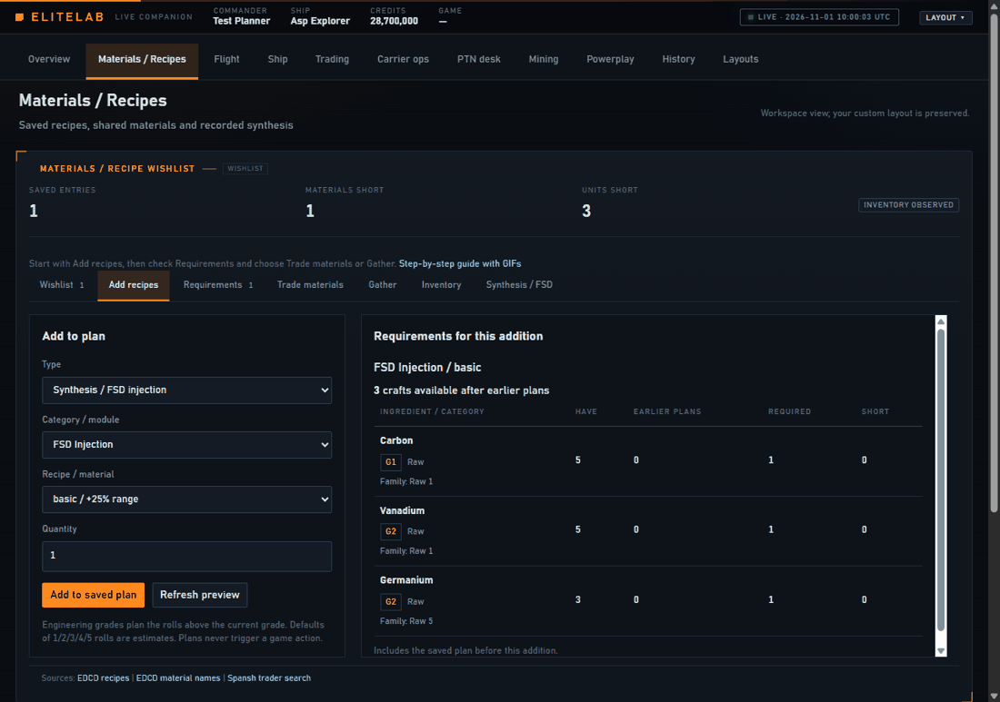
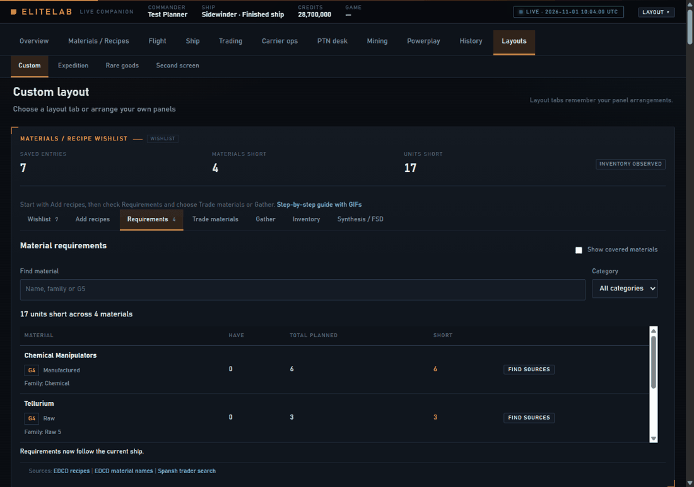
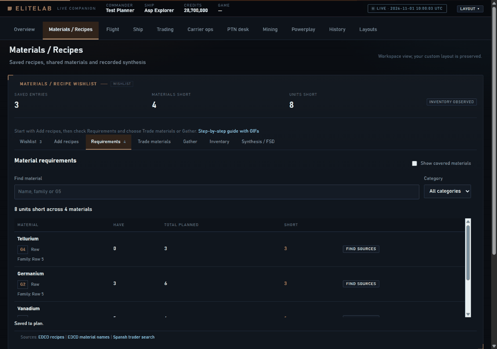

# Materials / Recipes: from a recipe to a finished plan

Open **Materials / Recipes** in the main navigation. The workspace contains the
saved material planner and your pinned build. Start with **Add recipes**; the
other tabs answer what you need, how to get it, and what the journal has observed.
The walkthroughs below record the real app with synthetic journals. Station
names, inventories and prices in these demonstrations are examples.

## Add your first recipe

1. Open **Add recipes** and choose a Type. Synthesis / FSD injection is a useful
   first example. Choose the category, recipe and intended quantity.
2. Read **Requirements for this addition** before saving. Have is observed stock;
   Earlier plans is stock already allocated to earlier entries. Required and
   Short describe this addition after those earlier entries.
3. Choose **Add to saved plan**, then open **Wishlist** to review the entry.
4. Open **Requirements** for the combined list. Filter by material name, family,
   grade or category; Show covered materials includes requirements already met.

Saving a recipe does not craft anything in the game. Quantities are your intended
work, not an automatic queue. After crafting, edit quantities or remove completed
entries yourself. A completed craft changes observed inventory but does not
silently change your intended plan.

| Type | What to enter | What it means |
| --- | --- | --- |
| Synthesis / FSD injection | Recipe, tier, quantity | Materials for that many crafts, sharing stock with earlier entries |
| Material target | Category, material, quantity | Desired units of a particular material |
| Engineering blueprint | Module, blueprint, current and target grades, quantity | Estimated rolls above the entered current grade |
| Experimental effect | Module, effect, quantity | Materials for applying the effect |
| Tech broker unlock | Module/unlock, quantity | Listed material costs; check non-material prerequisites in game |
| Pinned build | A build pinned in the build panel | Remaining requirements compared with your observed ship |

## Plan a ship, and choose whether it follows you

Pin an EDSY or Coriolis link, or supported SLEF/loadout JSON, in the build panel.
Review the comparison, then add **Pinned build** in the recipe composer.

Leave **Follow current ship** enabled when you want requirements to update as you
engineer or change ships. Turn it off to freeze this entry's current requirements
for a ship you are working toward. Frozen requirements stay fixed across ship
changes and restarts; the inventory used to cover them still updates live.
Turn following back on to recompute against the current ship and pinned target.
These are material requirements, not an archived complete build or a cargo lock.

Grade alone does not prove an upgrade is finished. A partly rolled final grade
keeps an estimated finishing budget. Missing or invalid quality stays unknown
and asks you to check the module. A deliberately partial target can be satisfied
at that target quality. Experimental effects are checked separately.

The default roll hints are 1/2/3/4/5 per grade. An unfinished or unknown current
grade conservatively reserves its whole grade hint, rather than pretending to
know the exact next-roll cost. The direct blueprint composer starts *above* the
entered current grade; use a pinned build for quality-aware finishing estimates.
**Materials covered** means you have the ingredients. **Upgrade complete** means
the observed module matches the target; these are separate results.

## Turn surplus into missing materials

Open **Trade materials**. Suggested exchanges show numbered steps in execution
order. Each step identifies the trader category, grades, families, units given
and received, the give:receive ratio, and projected stock before and after.
Cross-family exchanges are marked because their cost differs.

1. Check that your inventory has been observed and the suggestion uses genuine
   surplus after saved requirements and reserves.
2. Use a category button, or select a trader category and **Find material traders**.
3. Require large pads when needed. Compare system distance and arrival distance
   separately; a close system can contain a long station approach.
4. Copy the system/station, or open its Inara station link. Spansh supplies the
   candidate station reports; Inara is a cross-check, not the source of the list.
5. Make the exchanges in game. Recheck the updated stock before the next step.

Sorting changes the order of the returned nearby candidates. It does not search
the entire galaxy. Unknown approach distances stay unknown. Raw, Manufactured
and Encoded materials need their corresponding traders; suggestions do not trade
between categories. Unresolved shortages remain visible below the exchanges.

## Gather what trading cannot cover

In **Requirements**, use a material's source action, or open **Gather** and choose
**Find sites for shortfalls**. Review the site's method, system and body before
travelling. Copy the destination, then follow the described collection method.
Community farm locations are guidance, not a guarantee of current spawns.
Source suggestions are cleared when the plan or stock changes; search again for
the new shortages. Catalog provenance is listed in [Sources](SOURCES.md).

## Watch progress and distinguish it from evidence

**Inventory** shows current observed stock and materials received this session.
Received is not a net balance: spending materials does not subtract from the
session's receipts. Requirements recalculate as journal inventory changes.
Unknown inventory means a complete Materials snapshot has not been seen; it
must not be read as an empty inventory or as zero shortage.

**Synthesis / FSD** shows recorded crafts and boost evidence. Selecting a recipe
does not apply an injection. A journal Synthesis event provides craft evidence;
the FSD view distinguishes that from a planned injection or observed jet-cone
boost. Injection and jet-cone boosts are not added together.

## Recovery and everyday use

- Unsaved composer choices and active quantity edits survive live updates. Save
  an edited wishlist quantity explicitly; a failed save keeps the previous plan.
- Wait for an addition to finish before saving the next one. Refresh preview
  retries a failed calculation; reload catalogue retries catalogue loading.
- If exchanges look wrong, check recipe quantities, earlier allocations, frozen
  build requirements, and whether the latest full inventory has arrived.
- Changing workspaces preserves your custom layout. Arrow keys navigate the
  Materials tabs; narrow screens stack the editor and preview and scroll the
  active tab's contents.

For schemas and implementation details, see [Material plan](MATERIAL-PLAN.md),
[API](API.md), and [Testing](TESTING.md). GIF regeneration is documented there.
