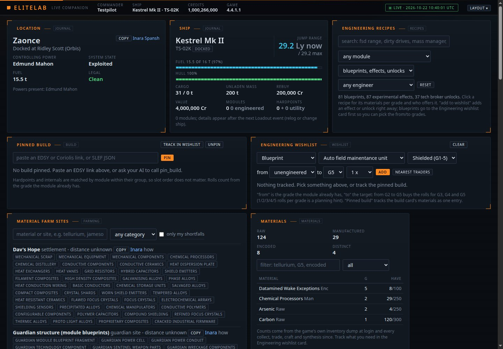

# EliteLab 0.6.0 Beta 1

**The first public beta of EliteLab 0.6.0.** A local Elite Dangerous companion
for trading, engineering and flying together. This release brings the current
staging build to a versioned download, with isolated playtest profiles and
shareable diagnostic bundles.

## Download

**Testing with friends on Windows? Choose the portable ZIP.** Python is included;
extract the complete archive and double-click **Start staging.cmd**. It keeps
test settings and saved plans separate from your regular installation.

| Platform | Package | Intended use |
| --- | --- | --- |
| Windows x64 | [Portable ZIP](https://github.com/MaverickArcane/EliteLab/releases/download/v0.6.0-beta.1/EliteLab-0.6.0-beta.1-windows-x64.zip) | Recommended for the Tailscale group playtest; includes log collection |
| Windows x64 | [Desktop installer](https://github.com/MaverickArcane/EliteLab/releases/download/v0.6.0-beta.1/EliteLab-0.6.0-beta.1-Setup-x64.exe) | Test the normal installed desktop experience |
| Debian / Ubuntu | [Debian package](https://github.com/MaverickArcane/EliteLab/releases/download/v0.6.0-beta.1/elitelab_0.6.0-beta.1_all.deb) | Test Linux desktop installation |
| macOS, Apple Silicon | [ARM64 installer](https://github.com/MaverickArcane/EliteLab/releases/download/v0.6.0-beta.1/EliteLab-0.6.0-beta.1-macos-arm64.pkg) | Test the native Mac menu-bar app |
| macOS, Intel | [x86_64 installer](https://github.com/MaverickArcane/EliteLab/releases/download/v0.6.0-beta.1/EliteLab-0.6.0-beta.1-macos-x86_64.pkg) | Test the native Mac menu-bar app |
| Source | [Source archive](https://github.com/MaverickArcane/EliteLab/releases/download/v0.6.0-beta.1/EliteLab-v0.6.0-beta.1-source.tar.gz) | Python 3.10+; run `python -m elitelab.staging run` for an isolated profile |

Each package has a matching `.sha256` file. [SHA256SUMS.txt](https://github.com/MaverickArcane/EliteLab/releases/download/v0.6.0-beta.1/SHA256SUMS.txt)
lists all download hashes. Installers are unsigned; macOS packages have an
ad-hoc signature, without Developer ID notarization. See the
[installation guide](https://github.com/MaverickArcane/EliteLab/blob/v0.6.0-beta.1/README.md#quick-start).

## Highlights

- **Cargo-first trading:** compare nearby buyers, build demand-limited sale
  routes and track deliveries with journal evidence.
- **Carrier ops and group mining:** coordinate crew quotas, paid carrier loading,
  reconnects and unloading over a private LAN or Tailscale connection.
- **PTN desk:** scout buyers, confirm actual carrier orders, prepare unloading
  adverts and resize station-trade plans up to 25,000 tonnes.
- **Materials and engineering:** clearer recipe planning, exchanges, farming,
  live versus frozen build requirements and partial-grade budgeting.
- **A cleaner cockpit:** focused workspaces, credit history, truthful shield
  status and a compact second-screen layout.
- **Better beta feedback:** isolated staging launchers, rotating redacted logs,
  exact build fingerprints and a one-action support ZIP collector on Windows.

## Join the group playtest

1. Everyone uses this same beta package and opens their own staging dashboard.
2. Join the host's private Tailscale network. In **Carrier ops > Connect crew**,
   the owner hosts on their Tailscale IPv4 address, party port **18767**.
3. Friends enter that address and the private party code from their own apps.
4. Test a small loading job first, then disconnect/rejoin and confirm that saved
   contributions survive. Follow the [staging guide](https://github.com/MaverickArcane/EliteLab/blob/v0.6.0-beta.1/docs/STAGING.md)
   for setup, firewall requirements and the session checklist.

The dashboard stays local at `http://127.0.0.1:18766/`. Each player reads their
own journals; the party shares scoped status and operation progress. Hosted
accounts and centralized journal synchronization are not part of this beta.

## Report a problem

Run **Collect staging logs.cmd**, describe what happened and the approximate
time, then review and send the generated ZIP privately to the organizer.
It includes recent redacted server logs and build information. Raw journals,
settings, saved plans and party credentials are excluded. Logs and notes can
still contain commander or location names; screenshots and browser errors can
be attached separately after removing private codes.

For reproducible public bugs, [open a beta report](https://github.com/MaverickArcane/EliteLab/issues/new?title=%5BBeta%5D%20)
with your beta version, OS, steps and expected versus actual result. Do not post
party codes or unreviewed logs in a public issue.

## Beta status and updates

This is a prerelease for feedback. Automated release checks cover the Python
matrix, browser workflows, package builds and native lifecycle tests. Real group
play, mining reward rules, downloaded-file OS prompts and actual sign-in cycles
still need player validation. Frontier Companion API integration is not included.

For isolated Windows testing, use the portable staging launcher. The standard
installers use the regular EliteLab application identity and data locations;
they do not install a separate beta app. Quit and back up your regular setup
before testing an installer. Native Mac metadata uses the numeric target
version `0.6.0`; the app and diagnostic reports identify `0.6.0-beta.1`.

For the next beta, close staging and extract the new portable ZIP into a new
folder. The same staging profile retains test plans; collect a report before
updating when investigating a problem. Beta releases do not replace the latest
stable release, **v0.5.0**.
