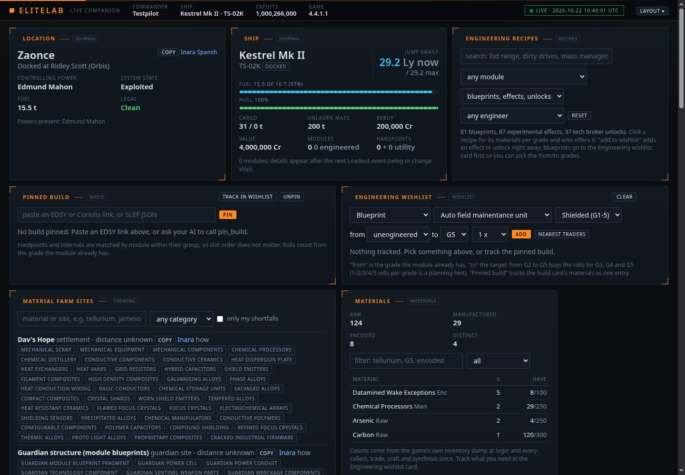

# EliteLab 0.6.0 Beta 2

**A security and reliability update for private multiplayer testing.** Beta 2
includes all security fixes merged in [PR #133](https://github.com/MaverickArcane/EliteLab/pull/133),
including the additional findings from the implementation review. Everyone in
the playtest should update to this build before starting a new party.

## Download

**For testing with friends on Windows, use the portable ZIP.** Extract the
complete archive into a new folder and run **Start staging.cmd**. Python is
included, and the staging profile keeps test settings and plans separate from
your regular installation.

| Platform | Package |
| --- | --- |
| Windows x64 | [Portable ZIP](https://github.com/MaverickArcane/EliteLab/releases/download/v0.6.0-beta.2/EliteLab-0.6.0-beta.2-windows-x64.zip) |
| Windows x64 | [Desktop installer](https://github.com/MaverickArcane/EliteLab/releases/download/v0.6.0-beta.2/EliteLab-0.6.0-beta.2-Setup-x64.exe) |
| Debian / Ubuntu | [Debian package](https://github.com/MaverickArcane/EliteLab/releases/download/v0.6.0-beta.2/elitelab_0.6.0-beta.2_all.deb) |
| macOS, Apple Silicon | [ARM64 installer](https://github.com/MaverickArcane/EliteLab/releases/download/v0.6.0-beta.2/EliteLab-0.6.0-beta.2-macos-arm64.pkg) |
| macOS, Intel | [x86_64 installer](https://github.com/MaverickArcane/EliteLab/releases/download/v0.6.0-beta.2/EliteLab-0.6.0-beta.2-macos-x86_64.pkg) |
| Source | [Source archive](https://github.com/MaverickArcane/EliteLab/releases/download/v0.6.0-beta.2/EliteLab-v0.6.0-beta.2-source.tar.gz) |

Every package has a matching `.sha256` file, and
[SHA256SUMS.txt](https://github.com/MaverickArcane/EliteLab/releases/download/v0.6.0-beta.2/SHA256SUMS.txt)
lists the download hashes. Installers remain unsigned; macOS uses an ad-hoc
signature without Developer ID notarization.

## Security patches included

- **Old party invitations stop at the room boundary.** A report that started
  under an old invitation is rechecked before changing state. Closing a party
  terminates accepted connections, preventing that report from carrying into a
  newly hosted room.
- **Connections have explicit limits.** Each listener allows 64 connections
  total and 16 per direct peer. Dashboard event streams allow 16 total and four
  per peer. Excess connections receive a best-effort 503 response and close.
  Capacity is recovered after disconnects, shutdown, and worker-start failures.
- **Malformed reports fail before state changes.** Duplicate/conflicting length
  headers, Transfer-Encoding, incomplete bodies and non-decimal lengths are
  rejected. Stalled bodies return a client error and close cleanly.
- **Security failures leave useful diagnostics.** Fixed rejection categories
  are rate-limited and included in support ZIPs without request credentials or
  bodies. Expected disconnects no longer produce traceback noise; unrelated
  application failures remain visible.
- **The browser policy is tighter.** Inline style attributes are blocked while
  tested gauges and layouts continue to work. Both listeners omit Python
  runtime versions from response headers.
- **Packaged builds include the new security helper.** The shared Debian/macOS
  manifest includes the helper used by the dashboard and party listeners.

These changes address #122 through #132. The
[pre-merge review](https://github.com/MaverickArcane/EliteLab/blob/v0.6.0-beta.2/docs/security/2026-11-14-premerge-review.md)
explains the reproduced attacks, fixes, evidence, and assessment limits. The
connection caps bound application resources; they do not prevent a saturated
network. No remotely reachable HTML injection sink was established by the CSS
policy demonstration.

## Validation

The reviewed fixes passed full Windows and Linux suites (831 tests reported on
each platform, with 11 and two skips respectively), 11 browser suites, 39 live
HTTP boundary checks, and local packaging checks. A real close/rehost reproduction
confirmed that an old report no longer enters the new room. The final scoped ZAP
scan completed 1,342 active requests with no high or medium alerts. Remaining
scanner observations and static-analysis coverage limits are documented in the
review; this is not a claim that all possible vulnerabilities have been excluded.

Publication also requires the beta workflow's Python matrix, browser checks,
native package builds and lifecycle smoke tests on this release tag. A real
host-plus-two-friends Tailscale session remains a player acceptance test.

## Update and test with friends

1. Collect a support ZIP if you are investigating a Beta 1 problem, then close
   the old staging app and party.
2. Extract Beta 2's portable ZIP into a new folder. Run **Start staging.cmd** and
   confirm the dashboard reports `0.6.0-beta.2`. The existing staging profile
   retains test plans.
3. Each player runs their own local dashboard. The host binds the party listener
   to their Tailscale IPv4 address, using party port **18767**, and shares the
   newly generated invitation privately.
4. Test a small loading job, disconnect/rejoin, then close and rehost the party.
   Confirm old invitations fail and saved contributions remain correct.
5. After a problem, run **Collect staging logs.cmd**, include the approximate
   time and steps, review the ZIP, and send it privately to the organizer.

The dashboard stays local at `http://127.0.0.1:18766/`. See the
[staging guide](https://github.com/MaverickArcane/EliteLab/blob/v0.6.0-beta.2/docs/STAGING.md)
for network setup and the playtest checklist. Logs can still contain commander
or location names; remove private codes from screenshots before sharing.

This is a prerelease and does not replace the latest stable release. Standard
installers use the regular EliteLab identity and data locations, so quit and
back up your regular setup before testing an installer. Native macOS metadata
continues to use numeric version `0.6.0`; the app and diagnostics identify
`0.6.0-beta.2`.
