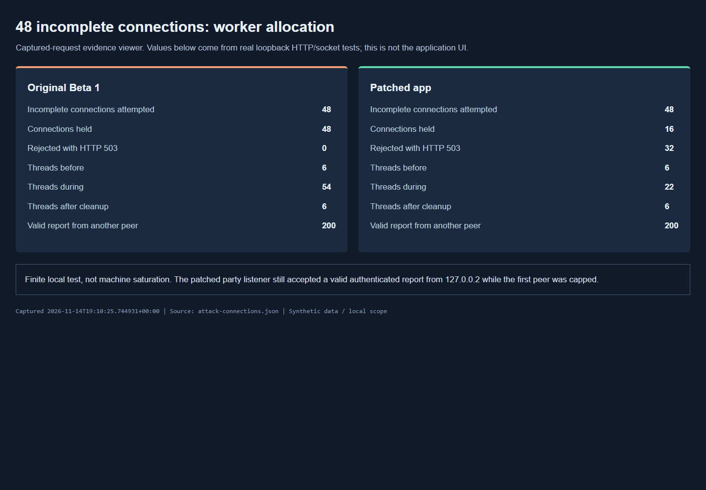
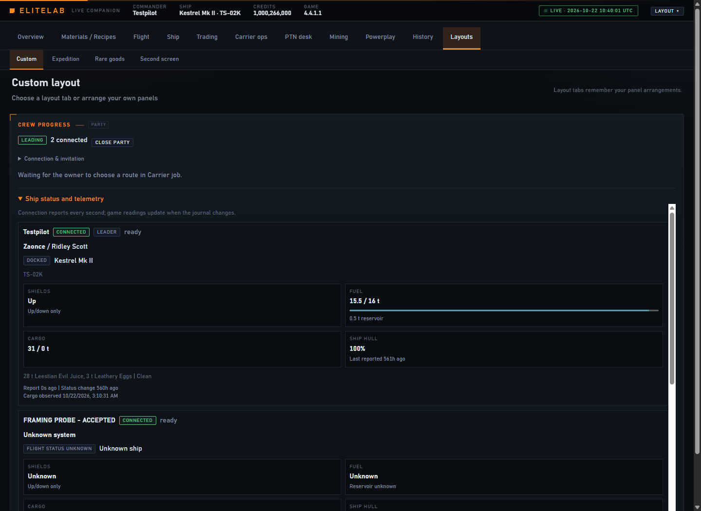
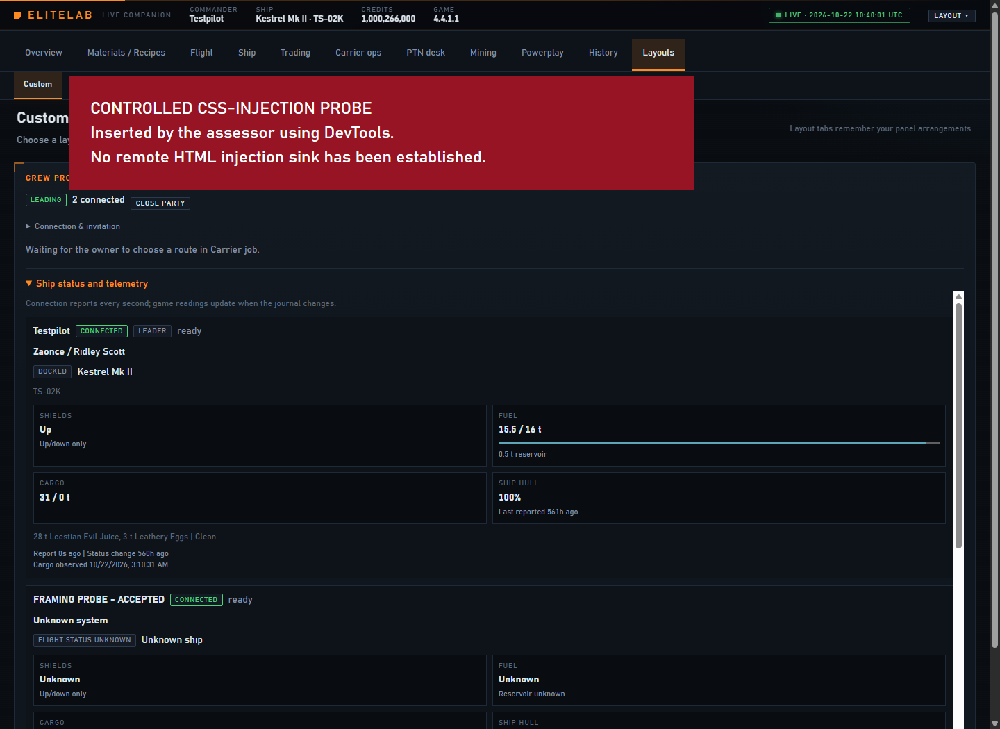
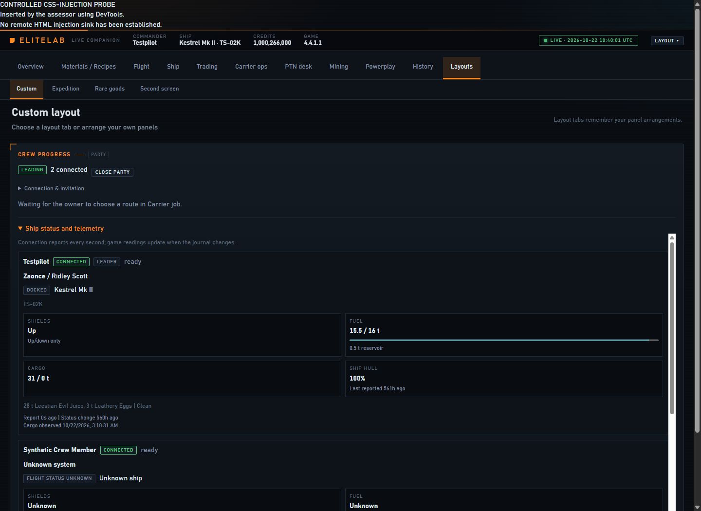

# EliteLab security assessment and remediation validation

Report EL-PT-2026-1114 / Revision 2 / 14 November 2026

Later pre-merge review found and fixed additional lifecycle and parsing gaps.
See [the implementation review](2026-11-14-premerge-review.md) for the current
merge assessment. This report remains the record of its original tested build.

## 01 / What an attacker could actually do

**The strongest demonstrated attack was resource consumption by a reachable network peer.** In original Beta 1, one peer held 48 incomplete HTTP requests and caused 48 additional server threads. No party invitation was needed to occupy those workers. The patched listener admitted 16 of those connections and rejected the other 32 before allocating workers. Another peer could still submit a valid party report.

An invited member could also submit an incomplete HTTP body that Beta 1 accepted as a complete report. The live demonstration changed that member's displayed name. This exposed a parsing defect; it did not give the member authority they lacked. The same request now receives HTTP 400 and leaves member state unchanged.

No account takeover, remote code execution, cross-member impersonation, or remotely exploitable SQL injection was established. A CSS overlay demonstration tests browser policy using assessor-inserted markup; it is explicitly conditional on a separate HTML injection bug that this assessment did not find.

| Item | Assessed significance | Local result |
| --- | --- | --- |
| #126: workers allocated before admission limits | Medium availability risk; bounded growth demonstrated, outage not attempted | Connection and event-stream limits implemented and tested |
| #122: incomplete/ambiguous party body accepted | Low; malformed own-member report processed | Rejects malformed framing before updating state |
| #123: missing denial evidence | Low detection gap | Fixed-label, rate-limited security events |
| #124: disconnect traceback noise | Low diagnostic disruption | Expected peer disconnects handled quietly |
| #127: inline CSS permitted | Conditional browser hardening; no remote injection path established | Strict style policy; UI migrated and browser tested |
| #128: Python version in HTTP headers | Low reconnaissance exposure | Generic Server header on both listeners |
| #125: missing packaged helper | Local packaging regression introduced during fixes | Shared package manifest corrected |

**Status: implemented and verified locally, not released.** Runtime fix commit `f2e6c22` includes the final capacity, CSS and header changes. Earlier fixes are in `4ffd0d7` and `f07289f`. The original comparison target is `669a2cbfe5e9f645acdba2c8671d9a5cfe674ae7`. Published Beta 1 was not modified by these local commits.

The previous report stopped with unresolved hardening work. This revision completes that work and distinguishes observed exploits, conditional demonstrations, scanner noise, and deployment work still outstanding.

## 02 / Attack paths and trust boundaries

The intended setup is a local dashboard for each player and a party listener reachable by selected Tailscale peers. Network reachability and party admission are different boundaries: TCP connections consume resources before a room code can be checked.

```text
Reachable peer, no invitation
  -> connect to dashboard or party port
  -> send a partial request and hold the socket
  -> Beta 1 allocates a worker for each accepted connection
  -> repeated connections increase threads and memory demand
  -> FIX: admission before worker creation; excess gets 503/close

Invited party member, valid invitation and own member identity
  -> POST /report with a false Content-Length
  -> send complete JSON but fewer bytes than declared, then EOF
  -> Beta 1 parses the short body and changes own member telemetry
  -> FIX: incomplete body gets 400; no state change

Assumed HTML injection sink (NOT established in this assessment)
  -> attacker-controlled style attribute reaches the page
  -> old browser policy permits an overlay hiding the dashboard
  -> FIX: browser blocks the style attribute
```

The first two paths were exercised against running original and patched applications. The third starts at an assumed injection sink supplied through DevTools to test a defense; it is not evidence that a remote attacker can insert that markup.

**Who is in scope?** A process on the host, or a peer allowed to reach the relevant listener, can attempt the network paths. A browser on an unrelated website has additional Origin/Host restrictions: the tested untrusted-origin and Host requests were rejected. Bearer-protected dashboard requests without credentials were also rejected. These observations do not prove that every possible browser-origin bypass is impossible.

**Where testing happened.** Three isolated instances used synthetic journal fixtures and loopback interfaces in WSL, with Chrome on Windows. No player data or public targets were used. The original instance ran from a separate detached worktree. The actual Tailscale ACLs, Windows firewall, Internet exposure, and multi-friend latency were not assessed by this loopback exercise.

## 03 / Connection growth: the practical availability path

**Finding #126.** A reachable peer does not need to join a party to make the HTTP server allocate a worker. The old server starts a thread after accepting a connection; that thread can wait for the rest of a request. Opening many partial requests therefore increases concurrent workers before authentication is reached.

The controlled test opened 48 partial requests from one loopback source, paced 20 ms apart. It measured process thread counts, attempted a valid report from a second loopback address, then closed every test socket. It deliberately stopped short of exhausting the machine.

| Measurement | Original Beta 1 | Patched app |
| --- | --- | --- |
| Attempted connections | 48 | 48 |
| Connections held | 48 | 16 |
| HTTP 503 rejections | 0 | 32 |
| Process threads: before / during / after | 6 / 54 / 6 | 6 / 22 / 6 |
| Valid report from second source | HTTP 200 | HTTP 200 |
| Dashboard health during probe | HTTP 200 | HTTP 200 |

**What this means.** The old behavior gives a reachable peer a way to increase server resource use. The experiment shows linear worker growth at 48 connections; it does not show a crash, quantify maximum sustainable traffic, or prove that 48 connections alone deny service. The Medium rating reflects an unauthenticated availability mechanism with a bounded proof, rather than a demonstrated outage.

**Fix.** Each listener now admits at most 64 connections total and 16 per direct peer address before starting workers. Dashboard event streams have separate limits of 16 total and 4 per peer. Excess connections receive a best-effort nonblocking 503 response and close. Cleanup releases capacity on normal completion, disconnect, and worker-start failure. Closed idle stream tabs release their quota promptly.

**Remaining limit.** These controls bound workers; they cannot guarantee availability under a coordinated or network-level flood. Four distinct source addresses can consume a 64-connection budget. A reverse proxy makes its clients share one peer limit unless the deployment architecture changes. No forwarded header is trusted to bypass this limit. Existing socket inactivity timeouts still apply.

Evidence: `attack-connections.json`, `tests/test_http_capacity.py`, and the captured evidence viewer below. Viewer pixels visualize recorded measurements; they are not an application screenshot.



## 04 / Malformed reports: exact request and consequence

**Finding #122.** The party receiver trusted the bytes returned by its body read without ensuring that it had received the declared length. A short read can still contain syntactically valid JSON. Beta 1 accepted that JSON even though the HTTP message was incomplete.

The attacker prerequisite is a valid invitation plus their own party member identity. The test first registers a synthetic member named `Synthetic Crew Member`, then prepares an otherwise valid report changing its own name to `FRAMING PROBE - ACCEPTED`.

```http
POST /report HTTP/1.1
Authorization: Bearer <synthetic invitation redacted>
Content-Type: application/json
Content-Length: 194

<184 bytes of valid fixture JSON, then write-side EOF>
```

The ten missing bytes are the defect trigger. EOF ends the read before the declared length arrives. The archived `attack_demo.py` generates the exact fixture body and performs the half-close; the excerpt above omits invitation material and is not a complete replay request.

| Observation | Original Beta 1 | Patched app |
| --- | --- | --- |
| HTTP response | 200 | 400 |
| Error message | None | `Incomplete report body.` |
| Member name after request | `FRAMING PROBE - ACCEPTED` | `Synthetic Crew Member` |
| State changed by malformed request | Yes | No |

**Impact in plain language.** An invited member could get the host to process a report that should have failed at the HTTP boundary. That member could already submit their own telemetry in a well-formed report, so this reproduction does not establish new privileges. No other member was overwritten. Calling this account takeover or proven HTTP request smuggling would overstate the result: no proxy desynchronization or second victim request was demonstrated.

**Fix and retest.** The receiver now requires one unambiguous Content-Length, rejects Transfer-Encoding combinations, checks body size/type, and verifies the actual body length before JSON parsing or member updates. The 39-check live suite includes duplicate length, transfer-encoding conflicts, short bodies, and state preservation. All passed.

The next two pages are actual browser captures of the running apps after the malformed request. Read them with `attack-framing.json`: a screenshot establishes visible state, while the recorded request and response establish how that state was reached. Invitations are kept collapsed in the UI.

## 05 / Live evidence: original Beta 1 accepts the report

Captured 2026-11-14 at 19:14:36 UTC, original Beta 1 on loopback port 57209. The party card displays **FRAMING PROBE - ACCEPTED** after the incomplete request returned HTTP 200. The visible member belongs to the synthetic attacker; the leader remains a separate member.



The card was expanded and placed in a full-width dashboard layout to make the result readable. The text and telemetry are application-rendered, not drawn over the screenshot. `live-captures.json` also records the visible card text and capture time. Original PNGs are supplied for zooming.

## 06 / Live evidence: patched app preserves member state

Captured 2026-11-14 at 19:14:38 UTC, patched app on loopback port 57453. The same malformed request returns HTTP 400. The party card retains **Synthetic Crew Member**. The fixture leader and normal telemetry continue to render.


This is the useful before/after distinction: the fixed app rejects the malformed report before applying the attempted name change. The archive also includes `evidence-framing.png`, a labeled viewer of the corresponding HTTP outcomes. That viewer is a presentation of captured data, not another application screen.

## 07 / CSS policy: a conditional attack, honestly demonstrated

**Finding #127.** The old policy allowed inline styles because the dashboard used them throughout its templates. If an attacker could place HTML in the page, that permission could let them position content over the interface, conceal controls, or imitate prompts. This assessment did not find a remotely reachable HTML injection sink, so that first step remains unproven.

To test the policy itself, the assessor used Chrome DevTools to insert the same explicitly labeled HTML element into each running app. Its style attribute requested a fixed red overlay. The label states that it was assessor-inserted and that no remote sink was established. No credentials were requested or collected.

| Browser observation | Original Beta 1 | Patched app |
| --- | --- | --- |
| Computed positioning | `fixed` | `static` |
| Computed background | `rgb(150, 20, 35)` | Transparent |
| Policy violation | None for this style | `style-src-attr` |
| Valid dynamic gauge | 37%, expected green | 37%, expected green |

**Fix.** The policy now uses `style-src 'self'; style-src-attr 'none'`. Static template styles were moved to the stylesheet. Dynamic gauges use narrowly checked percentages and colors applied through specific DOM style properties. Values cannot supply arbitrary CSS declarations, positioning, or URLs through those helpers. Browser regression checks reject a malformed color containing `position:fixed` and confirm that legitimate gauges still work.

Direct DOM style-property assignments by trusted application JavaScript remain available under this policy. That is intentional and consistent with browser CSP behavior. If an attacker already executes JavaScript, this CSS restriction does not contain that compromise. CSP complements output escaping; it does not replace it.

The screenshots on the next page demonstrate the policy difference, not remote code execution. Evidence: `live-captures.json`, `capture_live.mjs`, and the committed browser regression.

References: [MDN: style-src-attr](https://developer.mozilla.org/en-US/docs/Web/HTTP/Reference/Headers/Content-Security-Policy/style-src-attr), [W3C Content Security Policy](https://www.w3.org/TR/CSP/).

## 08 / Live evidence: the same CSS probe under both policies

**Original Beta 1, 19:14:36 UTC.** The assessor's inline style creates a fixed red overlay. This demonstrates the old policy's permission, conditional on markup insertion.



**Patched app, same capture session.** The browser refuses the style attribute. Probe text remains ordinary page content; it cannot take the requested fixed position or red background. `live-captures.json` records the `style-src-attr` violation.



## 09 / Detection, disconnect handling, and runtime headers

**Finding #123: rejected traffic lacked useful evidence.** Without a security event, the host could receive reports of failed joins or malformed traffic without enough local context to distinguish an auth failure from a protocol failure. This is a detection gap, not an extra way into the app.

The fixed app records a small set of reason/status categories with rate limiting. Request bodies, invitations, bearer tokens, arbitrary attacker text, and telemetry are excluded from those events. A suppression count indicates repeated events without producing a line for every attempt. Actual captured examples:

```text
security source=party event=request_rejected reason=invalid_request status=400 suppressed=0
security source=listener event=request_rejected reason=capacity status=503 suppressed=0
security source=dashboard event=request_rejected reason=authentication status=401 suppressed=0
security source=dashboard event=request_rejected reason=invalid_request status=400 suppressed=170
```

The original captured log has zero fixed-format security events. Patched logs contain the expected categories. The existing staging support collector carries these lines into the diagnostic ZIP; the archive includes a fresh sample collected from the final synthetic security events and verified to retain their categories. It is a collector test, not a claim that friends have already exercised the final build.

**Finding #124: abrupt peer disconnects produced traceback noise.** A reachable client can connect and close/reset during a response. The original capture contains 82 occurrences of peer-error traceback markers. That count describes this capture, not 82 distinct vulnerabilities or 82 verified outages. Repetition can obscure useful diagnostics in rotating logs.

The patch catches only connection reset, connection abort, and broken pipe around the HTTP handler. Unrelated exceptions still propagate and have regression coverage. The patched capture contains zero peer-disconnect traceback markers. Other application errors are not silently hidden; fixture/offline provider messages can still appear.

**Finding #128: passive runtime fingerprinting.** Ordinary responses previously disclosed `Server: EliteLab Python/3.12.3`. A reachable client could learn that runtime string and use it to guide further research. The header alone proves neither an applicable runtime vulnerability nor compromise.

Both listeners now return `Server: EliteLab`, including inherited error responses. Fresh Nmap probes and HTTP tests confirm this. The app's intentional product-version health field remains available. Removing a banner is a small reconnaissance reduction, not a substitute for runtime updates.

Evidence: `logging-evidence.json`, server logs, `attack-headers.json`, `nmap-final.*`, and committed transport/capacity tests.

## 10 / Retest results, including the scanner false alarm

| Check | Final observation |
| --- | --- |
| Python full suite, Windows | 823 tests reported; 11 skipped; 812 executed successfully |
| Focused capacity tests, Linux | 5 passed: peer/global caps, startup-failure cleanup, stream quotas, headers/policy |
| Focused transport regression | 7 passed in the pre-change check; included again in the final full suite |
| Chrome | Main dashboard, expedition, PTN, and release suites passed; main suite includes strict-style regression |
| Live HTTP boundary probes | 39/39 passed |
| ZAP 2.17.0, stable final scan | 1,342 active requests across four targets; all scans finished; 0 high, 0 medium, 1 low, 28 informational alert records |
| Bandit 1.9.4 | 208 raw findings: 1 high, 16 medium, 191 low; no scan errors |
| Semgrep 1.185.0 | 219 rules, 129 targets, 5 raw findings; no scan errors |
| Nmap 7.94SVN | Four explicit patched loopback ports; expected listeners and generic runtime headers |

**A high SQL-injection alert occurred in the first scan of these fixes.** That scan overlapped the live screenshot demonstration, which changed party state. ZAP compared changing snapshots on `/api/party?probe=...` and raised a Boolean SQL heuristic. The original alert remains in `zap-concurrent-report.json/html`; it was not deleted to improve the summary.

The route registers `lambda q: core.store.get(NS)`: it ignores the tested query parameter and returns an in-memory snapshot, with no SQL operation at that endpoint. Twelve sequential replays of ordinary, true-condition, and false-condition inputs returned identical response hashes (`sql-alert-replay.json`). A repeat scan with stable party state no longer raised the SQL alert. Together, source inspection, controlled replay, and the stable rerun support a false-positive disposition for this specific alert. They do not prove the absence of SQL vulnerabilities everywhere else.

**Raw warnings are not zero.** The final ZAP low observation is a Unix timestamp in fixture data; informational families concern comments and user-agent response behavior. No secret or exploit path was established from these. The former inline-style and Python-header warnings no longer occur.

Bandit's high SHA1 warning concerns a deterministic route identifier, not a password hash, signature, or authorization check. Reviewed SQL constructions use fixed fragments with separately bound values. Other retained categories include intentional bind configuration, provider URL helpers, assertions, test launchers, and exception handling. Semgrep's retained HTML matches were reviewed for escaping/numeric formatting, and subprocess matches for controlled arguments. Their unchanged raw findings are preserved so reviewers can challenge those dispositions.

ZAP used the same bounded target/rule scope as the prior retest; out-of-band and selected timing rules were excluded. `zap-summary.json` records the exact exclusions. Static scans and these live probes are not exhaustive. The earlier empty pip-audit inventory covers zero third-party Python runtime dependencies; it is not an operating-system or CPython CVE assessment.

## 11 / Evidence, reproduction, and what is ready to ship

The reviewable changes are on local branch `security/beta1-purple-team` in `C:\Users\dbric\elitelab-security-20261114`. The separate original-beta worktree was used only for comparison. The owner's normal checkout and staging checkout were not changed.

The evidence ZIP contains this PDF and self-contained HTML, the Markdown source, full-size screenshots, raw scan outputs (including the superseded SQL alert), test logs, bounded probe scripts, issue snapshots, a source manifest, a cumulative patch, and a SHA-256 inventory. Audit credentials are scrubbed from text evidence; private target registries are excluded.

| Start here | What it answers |
| --- | --- |
| `attack-framing.json` and `live-framing-*.png` | Which malformed request changed state, and what the user saw |
| `attack-connections.json` | How many workers the same peer caused before and after |
| `live-captures.json` and `live-csp-*.png` | What CSS the browser allowed or blocked |
| `logging-evidence.json`, server logs | What the host can diagnose from rejected requests |
| `zap-summary.json`, `zap-report.json/html` | Final scope, request totals, and retained alerts |
| `zap-concurrent-*`, `sql-alert-replay.json` | Original high alert and evidence supporting its disposition |
| `bandit.json`, `semgrep.json` | Unfiltered static findings for independent review |
| `source-manifest.json`, `remediation.patch`, `issues.json` | Exact tested source and delivery tracking |

Run the committed focused regressions from the worktree root:

```text
python -m unittest discover -s tests -p test_http_capacity.py -v
python -m unittest discover -s tests -p test_security_transport.py -v
python -m unittest discover -s tests -q
node tests/browser.mjs
```

The archived live scripts use this workstation's WSL paths and private synthetic target registry. They document the experiment; they require path/configuration adjustment before use on another workstation. Use isolated test state and credentials. Do not aim the comparison harness at a player's active session.

**Delivery still required:** review/merge these local commits, run release packaging/CI, publish a new beta, and test one host plus at least two friends across the actual tailnet. Confirm ACL reachability, valid joins/reconnects, event-stream behavior, and a build-matched support ZIP from each participant. The tested per-peer limits may need tuning if traffic is consolidated behind one proxy.

Issues [#122](https://github.com/MaverickArcane/EliteLab/issues/122), [#123](https://github.com/MaverickArcane/EliteLab/issues/123), [#124](https://github.com/MaverickArcane/EliteLab/issues/124), [#125](https://github.com/MaverickArcane/EliteLab/issues/125), [#126](https://github.com/MaverickArcane/EliteLab/issues/126), [#127](https://github.com/MaverickArcane/EliteLab/issues/127), and [#128](https://github.com/MaverickArcane/EliteLab/issues/128) remain delivery tracking items. Local verification is complete for the changes described here. Published Beta 1 and real multiplayer deployment are not covered by that local pass.
