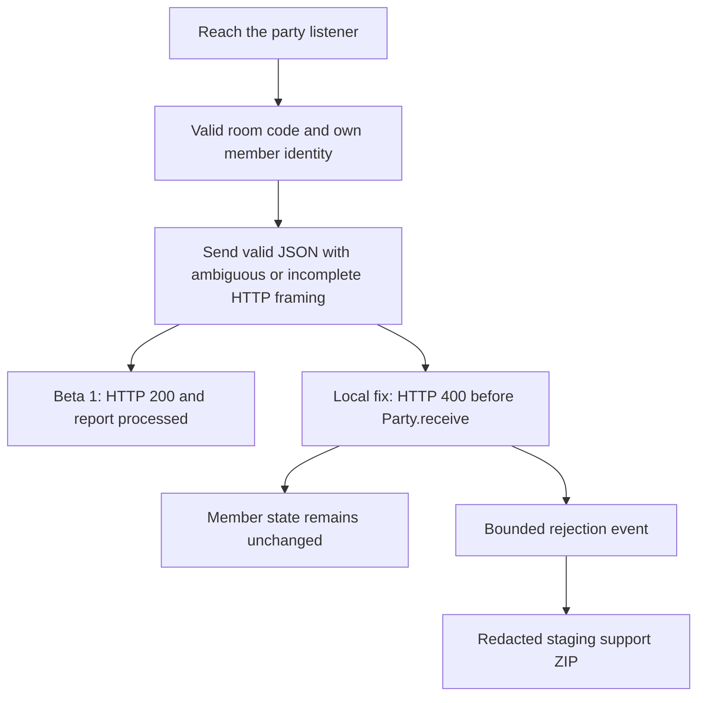

# EliteLab | Penetration test and remediation validation

**Report EL-PT-2026-1114 / Revision 1.1**

**Assessment date:** 14 November 2026

**Target:** EliteLab 0.6.0-beta.1 and local security fixes

**Prepared for:** EliteLab maintainer

**Handling:** Maintainer review; synthetic data only

## 01 / Executive assessment

**Retest verdict: PASS WITH OBSERVATIONS.** The three confirmed low-severity
findings are remediated in the local security branch. All 39 live boundary and
state-integrity checks passed. Raw scanners still report documented observations;
this report does not describe the product as having zero vulnerabilities.

The initial assessment found a party protocol validation gap and two diagnostic
weaknesses. No authentication bypass, cross-member identity takeover, executable
XSS, SQL injection or high/critical exploit was confirmed in the tested scope.
The strongest demonstrated path requires a valid party invitation and the
caller's own member identity; its impact is accepting malformed messages, not
gaining another member's privileges.

| Finding | Rating | Retest | Tracking |
| --- | --- | --- | --- |
| EL-SEC-01 / Ambiguous or incomplete party bodies accepted | Low | Fixed locally; malformed requests return 400 without state changes | [#122](https://github.com/MaverickArcane/EliteLab/issues/122) |
| EL-SEC-02 / Missing rejection evidence | Low | Fixed locally; bounded events survive support export | [#123](https://github.com/MaverickArcane/EliteLab/issues/123) |
| EL-SEC-03 / Disconnected peers generate noisy tracebacks | Low | Fixed locally; disconnect handling and live probes pass | [#124](https://github.com/MaverickArcane/EliteLab/issues/124) |

**Release position.** The implementation is local on
`security/beta1-purple-team`; the published Beta 1 binaries are unchanged. The
issues remain open for review, merge and a subsequent beta release. Passing this
retest does not mark those release steps complete.

**Definition of the verdict.** The confirmed reproductions must fail safely,
valid party operations must continue to work, detection evidence must be useful
and credential-free, and every residual scanner family must have a documented
disposition. A scan that failed to execute, a skipped test or an unexamined new
warning would not satisfy that definition.

## 02 / Scope, environment and method

| Item | Assessed configuration |
| --- | --- |
| Baseline | Tag `v0.6.0-beta.1`; commit `669a2cbfe5e9f645acdba2c8671d9a5cfe674ae7` |
| Runtime remediation | Commit `4ffd0d7`; HTTP framing, rejection evidence, disconnect handling |
| Retest source | `f07289f`, with timeout, concurrent-logging and exception-preservation regressions plus the shared package manifest correction |
| Targets | Default loopback dashboard; token-protected dashboard; separate code-protected party listener |
| Data | Synthetic journal fixtures, isolated settings/data/instance paths, offline providers |
| Platforms | WSL Ubuntu / Python 3.12.3 for live scans; Windows / Python 3.14 for full regression suite and Chrome checks |
| Network | Only the three allocated `127.0.0.1` audit ports; Windows localhost access verified |

The exercise combined source-assisted manual review, raw HTTP attacks, automated
active/passive scans, browser adversarial checks and blue-team evidence review.
The first pass established baseline behavior. This fresh retest started
new application processes and reran the scanners against the fixed source.
Original evidence remains in `artifacts/security`; new evidence is in
`artifacts/security-retest`.

The ZAP scan explicitly seeded pages/assets and selected read APIs. Four active
targets covered `/api/health`, history analytics, the root page and party status.
It used two workers and finite scan budgets. No spider followed arbitrary links;
destructive owner commands and selected callback/timing/resource-exhaustion rules
were excluded. Authenticated dashboard and party boundaries were exercised by
custom probes, not a complete authenticated ZAP crawl.

Not assessed: other tailnet machines, real Tailscale ACLs, public Internet
exposure, OS privilege escalation, native-binary reverse engineering, embedded
CPython/OS-library CVEs, prolonged saturation, or every business workflow.
The absence of third-party Python runtime packages does not cover those risks.

## 03 / Attack path and trust boundaries

The diagram shows the reproduced validation path and the observed fixed result.
Network reachability alone does not bypass the party code or member identity.



**Prerequisites:** the caller can reach the party port and knows the current room
code. It uses a valid identity/secret belonging to itself. The assessment supplied
synthetic credentials; it did not obtain or crack anyone's invitation.

**Action:** submit a normal JSON report using two length headers, a length plus
transfer-encoding header, or a declared length longer than the supplied bytes
followed by a write-side close.

**Baseline observation:** each of the three requests returned 200. The party
handler accepted the JSON and processed the member's report. No reverse proxy,
request-smuggling chain, cross-member write or privilege escalation was shown.

**Retest observation:** each returns 400. The replay attempts to replace the
member name with `FRAMING_ATTACK_SENTINEL`, then reads the authenticated party
view. The sentinel is absent and the original synthetic member remains present.
Unit tests independently verify that `Party.receive` is never called.

**Detection path:** the rejected request now yields a fixed-label event in the
server log. The staging collector exports this evidence without request headers,
bodies or credentials. This closes the associated diagnostic gap.

**Separate unauthenticated path:** a reachable peer can reset TCP connections
without a room code. Baseline probes caused server-thread tracebacks; the fixed
handler closes those connections quietly. Availability exhaustion beyond the
bounded test remains a separate, unverified risk.

## 04 / Finding EL-SEC-01: party request framing

**Rating:** Low. **Status:** remediated locally. **Issue:**
[#122](https://github.com/MaverickArcane/EliteLab/issues/122).

**Affected boundary:** `Party.handler.do_POST` in `modules/party/module.py`.
The baseline used the first Content-Length and parsed whatever `read(size)`
returned. It did not reject duplicate lengths or transfer encodings, and did not
require the returned byte count to match the declared length.

| Controlled request variation | Baseline | Fixed retest |
| --- | --- | --- |
| Two Content-Length headers | 200; report accepted | 400; state unchanged |
| Content-Length plus Transfer-Encoding | 200; report accepted | 400; state unchanged |
| Declared length exceeds bytes, then EOF | 200; report accepted | 400; state unchanged |
| Body stalls before the declared length | Not established in baseline | 400 timeout; `receive` not called |
| Ordinary authenticated report | 200 | 200 |

**Impact and severity rationale:** malformed messages could reach shared party
state within an already-authenticated boundary. A valid member can already
report its own telemetry. The test did not establish additional authority or a
downstream proxy exploit, so this is rated as protocol/integrity hardening.

**Remediation:** require exactly one length; reject every Transfer-Encoding;
enforce the existing 64,000-byte cap; verify the full byte count before parsing;
handle a stalled body as a controlled 400 response. Authentication and origin
checks remain ahead of report processing.

**Proof of repair:** `probes-retest.json` records both status and state-integrity
checks. `test_ambiguous_and_incomplete_bodies_never_reach_party_state` covers
multiple malformed cases plus a valid control.
`test_stalled_body_times_out_before_touching_party_state` exercises a real socket
with a shortened test timeout and then verifies normal reporting still succeeds.

**Closure criteria:** merge reviewed changes and publish a new beta; preserve the
raw framing tests in CI. Local success is not evidence that existing testers have
received the fix.

## 05 / Findings EL-SEC-02 and EL-SEC-03: diagnostic resilience

### EL-SEC-02 / Missing rejection evidence

**Rating:** Low. **Status:** remediated locally.
[#123](https://github.com/MaverickArcane/EliteLab/issues/123).

Rejected requests correctly returned errors, but the server did not produce
dedicated security events. An organizer receiving a staging ZIP could not tell
that authentication, cross-origin or malformed-report rejection paths had run.

The new per-listener `SecurityEvents` helper records fixed source/reason/status
labels. It accepts no request data. Live retest produced dashboard
400/401/403/415 and party 400/403 evidence. Example:

```text
security source=party event=request_rejected reason=invalid_request status=400 suppressed=0
```

Sequential and concurrent tests each exercise 1,000 rejections. Only one warning
is emitted during the interval; the next interval reports 999 suppressed events.
The exported sample support ZIP preserves these events and excludes audit
credentials. Events are limited per status per listener, not per caller. They do
not identify attackers, include all requests, or flush suppressed counts on exit.

### EL-SEC-03 / Peer disconnects obscure useful diagnostics

**Rating:** Low. **Status:** remediated locally.
[#124](https://github.com/MaverickArcane/EliteLab/issues/124).

Baseline Nmap probes generated ConnectionResetError server-thread tracebacks on
the party port. Repetition could churn the bounded logs and obscure the earlier
failure an organizer needs to diagnose. No service outage was demonstrated.

The handler now catches only connection reset, connection abort and broken pipe,
then closes the connection. A regression verifies that unrelated application
errors still propagate. Fresh Nmap and bounded incomplete-connection probes
produced no server-thread tracebacks. Dashboard health remained 200 while 16
connections were held on each listener in turn; this is not a saturation test.

## 06 / Scanner results and residual observations

**Raw findings remain visible.** Scanner exit/status data, unchanged warning
counts and their dispositions accompany this report. No rules were suppressed
to manufacture an empty report.

| Tool | Fresh retest | Interpretation |
| --- | --- | --- |
| OWASP ZAP 2.17.0 | Four active targets plus passive seeded traffic; all completed | No high alerts; retained CSP/header/informational observations below |
| Bandit 1.9.4 | 208 findings: 1 high, 16 medium, 191 low | Same findings as baseline; heuristic categories reviewed in context |
| Semgrep 1.185.0 | 219 rules, 129 targets, 5 findings, no errors | Same five findings as baseline; numeric formatting, escaping and controlled subprocess paths reviewed |
| Nmap 7.94SVN | Three explicit audit ports; TCP connect, version-light, HTTP headers/methods | Expected listeners, trusted-Host rejection, no post-fix tracebacks |
| Python/Chrome | 39 live checks; 818 full-suite tests with 11 skips; two browser suites | Confirmed reproductions blocked; valid behavior retained; 807 full-suite tests executed |

| Observation | Disposition and remaining action |
| --- | --- |
| ZAP: inline CSS allowed by CSP | Open defense-in-depth debt. Existing UI uses inline styles; removing permission requires a tested UI migration. No script execution was shown. |
| ZAP: Server header version disclosure | Open low-severity fingerprinting observation. Does not demonstrate compromise. |
| ZAP: timestamps, source comments, user-agent differences | Informational in the fixture responses. No confidential production data or exploitable path was demonstrated. |
| Bandit/Semgrep: SHA1 in route ID | Contextual false positive for cryptographic security: deterministic route label, not password storage, signing or authorization. |
| Bandit: SQL string construction | Fixed SQL fragments; user values bound separately. Analytics injection probes found no exploit. |
| Bandit: broad-bind literals / URL helpers | Intentional configuration or validation matches; provider URLs reviewed at call sites. LAN deployment and future callers still require care. |
| Bandit: assertions, subprocess, default tokens, exception handling | Primarily build/smoke assertions and controlled launchers; idle token defaults are not hardcoded credentials. Low warnings do not establish an HTTP-to-shell path. |
| Semgrep: PTN/recipe HTML | Text/href escaping and numeric formatting protect the reviewed sinks. Injected-text browser checks pass. |
| Semgrep: Windows smoke-test subprocess | Fixed test executables and controlled arguments; no remote input-to-command path established. |

The previous empty pip-audit inventory contained zero third-party Python runtime
dependencies. It is not a CPython, operating-system or development-tool CVE scan
and is not used as a security pass criterion in this retest.

The residual connection/SSE resource limit remains an architectural risk. The
exercise did not intentionally exhaust the machine. Keep dashboards local and
remote party access limited to intended Tailscale peers pending broader testing.

## 07 / Evidence, reproduction and release gate

The evidence archive includes this report in PDF/HTML/Markdown, a patch, exact
test/scan outputs, local harnesses, an issue register, a support ZIP sample, and
a SHA-256 manifest. Audit credentials and ZAP API configuration are excluded;
tool-log credentials are redacted before packaging.

| Evidence | What it establishes |
| --- | --- |
| `baseline/probes-before.json` | Original three malformed-body 200 responses; 33/36 checks passed |
| `retest/probes-retest.json` | 39/39 checks, including member-state preservation |
| `retest/zap-summary.json`, `zap-report.html/json` | Targets, rule selection, completion and raw alert evidence |
| `retest/bandit.json`, `semgrep.json`, `scanner-comparison.json` | Raw static findings and before/after comparison |
| `retest/nmap-after.*`, `bounded-connections.json` | Bounded listener probes and health observations |
| `retest/tests-after.log`, `transport-linux.log`, browser logs | Full Windows regression, focused Linux coverage and Chrome exercises |
| `retest/local-server.log`, `protected-server.log` | Fixed-label detection events and absence of observed disconnect tracebacks |
| `staging-support-example.zip` | Security evidence survives the existing support collector |
| `issues.json`, `source-manifest.json`, `remediation.patch` | Finding ownership, source identity and reviewable implementation |

Run committed regressions from the repository root:

```text
python -m unittest discover -s tests -p test_security_transport.py -v
python -m unittest discover -s tests -q
node tests/expedition-browser.mjs
node tests/ptn-browser.mjs
```

The archived live harness is workstation-specific. Its setup creates synthetic
targets and private credentials outside the repository. `live_probes.py retest`
replays the boundary checks; `run_zap.py` uses exact loopback scope;
`postfix_checks.py` runs bounded Nmap/connection tests. The source folder and WSL
tool paths must be adjusted on another machine. Never reuse live player data.

**Release gate:** review and merge the local branch; run CI/package validation;
publish a new beta; then test owner plus two crew over the real tailnet and
collect their build-matched support ZIPs. Issues #122-#124 remain open through
those delivery steps. The report's local retest verdict does not substitute for
that multiplayer and release validation.

**Packaging correction discovered during retest:** the first fresh full suite
failed because the now-tracked `core/security.py` was missing from the shared
Debian/macOS file manifest. This local-only regression is tracked in
[#125](https://github.com/MaverickArcane/EliteLab/issues/125). The sorted manifest
now includes the helper. An isolated copied application imports the dashboard,
party and security modules successfully; the final full suite is rerun after
that correction. `tests-packaging-failure.log` preserves the initial failure and
`package-imports.json` records the staged-copy check. This is a packaging defect,
not an additional remote security finding.

References: [original assessment](2026-11-14-beta1-assessment.md),
[ZAP API](https://www.zaproxy.org/docs/api/),
[Bandit](https://bandit.readthedocs.io/),
[Semgrep](https://semgrep.dev/docs/), [Nmap](https://nmap.org/book/man.html).
